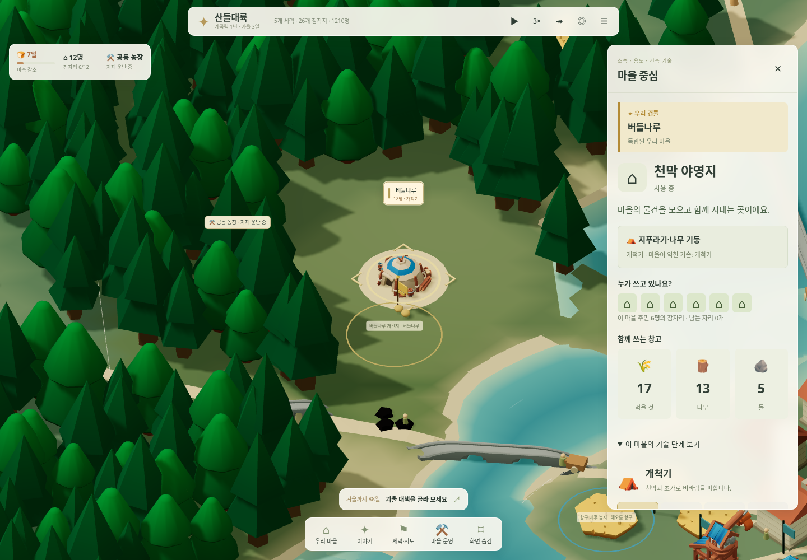
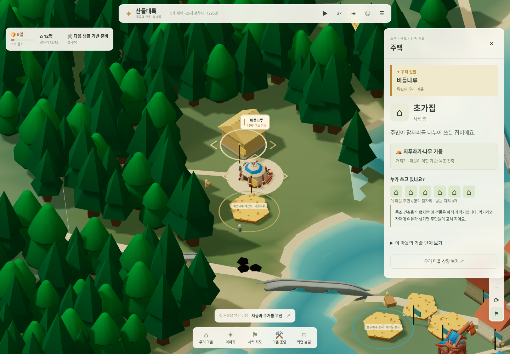
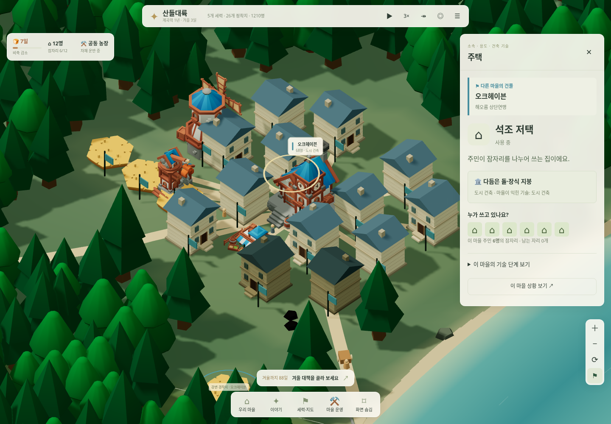

# 건물의 소속·사용·건축 기술

실제 게임: [버들나루 실행](https://kkhkkh20-bit.github.io/everworld-game/frontier.html). 이전 연구 페이지의 정적 UI 시안과 달리 이번 기능은 `frontier.html`에 적용했다.

## 건물을 보고, 눌러서 이해하기

우리 건물에는 이중 깃발·꼭대기 장식과 금빛 바닥 모서리가 있다. 다른 마을에는 소속 세력 색의 단일 깃발을 단다. 같은 보호 세력에 속하더라도 우리 건물의 표식은 유지한다. 다른 마을을 모두 적으로 표시하지 않는다.

지도 건물 자체를 클릭·터치하면 건물 소속, 용도, 실제 건축 재료와 단계, 현재 사용 상태를 보여준다. 선택한 건물에는 바닥 고리가 생긴다. 마을 정보의 접힌 건물 목록에서도 선택할 수 있다. 지도 드래그·핀치 후에는 건물을 선택하지 않는다.

- **집·마을 중심:** 현재 마을 인구와 실제 잠자리 용량에 따른 사용 인원과 남는 자리. 폐쇄된 집의 잠자리는 사용할 수 없다.
- **농장:** 실제 수확 위치로 사용하는 농장의 식량 작업조와 현재 행동. 여러 농장 중 공동 수확 장소는 첫 사용 가능한 농장이다. 다른 밭의 생산 기여와 개별 현장 직원 배정을 같은 것으로 표시하지 않는다.
- **작업장:** 나무·돌 생산 효과를 받는 실제 작업조. 모두가 작업장 안에서 일한다고 설명하지 않는다. 실제로 돌 생산도 돕기 때문에 명칭을 ‘공동 작업장’으로 맞췄다.
- **시장:** 마을과 오가는 실제 교역 수레 수. 시장이 현재 모든 거래의 필수 조건이라고 설명하지 않는다. 이주·지원·조공 수레를 거래 수레로 합산하지 않는다.
- **방앗간:** 마을 전체의 식량 생산·보관 효과. 별도 상주 직원을 만들어 표시하지 않는다.
- **마을 중심:** 함께 쓰는 식량·나무·돌 재고와 물건을 가져오는 실제 작업조.

작업조를 누르면 현재 행동·짐·직업을 확인하고 위치로 이동할 수 있다. 현재 시뮬레이션은 여전히 마을당 6개의 공동 작업조이며 주민 개인과 같은 단위가 아니다. 개인별 이름·가족·과거를 가공하지 않았다. 집의 인원도 개인별 주거 명단이 아니라 실제 인구와 잠자리의 배분이다. 이전에 기획한 개인 카드·주거 이력은 별도 개인 모델이 필요하다.

## 네 가지 건축 기술

| 단계 | 모습 | 자동으로 익히는 조건 | 새로 지을 수 있는 시설 |
|---|---|---|---|
| 0 개척기 | 천막·초가집, 나무 기둥과 지푸라기 지붕 | 처음 시작하는 우리 마을 | 주택·농장 |
| 1 목조 건축 | 통나무 벽·나무 지붕 | 주택이 있고 건설 경험 24 이상 | 공동 작업장·시장 |
| 2 석조 건축 | 돌벽·기와 지붕·굴뚝 | 작업장이 있고 경험 100 이상 | 풍차 |
| 3 도시 건축 | 다층 석조 저택·장식 지붕·큰 회관 | 풍차·시장과 경험 220 이상 | 높은 단계의 건축·개축 |

실제 공사 완성은 경험 16, 개축은 8을 더한다. 가동 가능한 작업장이 있고 굶지 않으며 시설 상태가 60%를 넘으면 하루에 0.5를 익힌다. 새 대륙에서는 더 높은 기술의 마을과 실제 왕복 교역을 마쳐도 경험 6을 얻는다(같은 상대는 20일 간격). 경험은 누적이며 단계가 내려가지는 않는다. 기술 상세 창에서 네 단계와 다음 조건·진행을 볼 수 있다. 연구 버튼이나 새로운 연구 자원을 추가하지 않았다. 건물 위치·일 배정·건설·기술 습득은 계속 자동이다.

기존 세계의 수도·성채는 도시 건축, 항구는 석조, 농업·삼림 마을은 목조에서 시작한다. 이는 새 세계 생성 시 기존 마을의 초기 조건이며, 우리가 와서 함께 원시 단계에서 시작하는 구성이 아니다. 우리 마을은 개척기에서 시작한다.

기술을 익혀도 기존 건물의 모습은 즉시 변하지 않는다. 공사 시작 시점의 기술을 새 건물에 기록한다. 기존 건물은 우선할 새 공사가 없고, 식량이 32일분을 넘고, 자재에 여유가 있을 때 한 단계씩 자동 개축한다. 개축은 실제 재료 운반과 공사 시간을 거친다. 건물 번호·주택 수·잠자리 용량은 유지한다. 기술 수준에 따른 별도 생산 보너스를 임의로 더하지 않았다.

단계별 개축 비용은 나무 `8 + 단계×4`, 돌은 목조 2·석조 14·도시 17, 공사량은 `5 + 단계×2`다. 시작하려면 그 비용 외에도 나무 24·돌 12를 남길 여유가 필요하다. 위기 중 기술·미관을 위해 생존 자재를 우선 소비하지 않는다. 농장은 작물 모양이므로 건축 재료를 바꾸는 개축에서 제외한다.

## 실제 화면

[휴대폰의 우리 건물](../assets/screenshots/architecture-own-390.png) · [휴대폰의 다른 마을 건물](../assets/screenshots/architecture-city-390.png)

모두 실제 게임 화면이다. 첫겨울 이후 화면은 기본 세계에서 자급 방침 선택 후 180일을 실제 진행했다. 초기 기술과 기존 건물의 재료가 다를 수 있으며 정보창에 그 이유를 보여준다. 모델 비교를 위해 재고·인구를 조작한 장면이 아니다.

## 저장·구현·검증

이 건축 업데이트는 `everworld_valley_v2`의 경제·인구·위치·건물 역할을 보존한다. 후속 [새 대륙 업데이트](continent-frontier.md)는 `everworld_continent_v1`을 별도로 사용하며 이전 슬롯은 설정에서 계속 열 수 있다. 건물 고유 번호와 기술·건축 단계·실제 개축 시각을 저장한다. 이전 저장에 건축 정보가 없으면 현재 시설에서 단계를 정하고 번호를 한 번만 부여한다. 이전 시점의 연구 날짜나 개축 사건을 만들어 넣지 않는다. 추가 이후의 학습 날짜만 실제 처리에서 기록한다.

기존 KayKit 모델은 유지했다. 초가·통나무집·돌집·석조 저택과 소유 표식은 Three.js 기하로 직접 만들고, 각 모델의 부품을 하나의 색상 포함 메시로 합쳐 재사용한다. 참고 게임의 스크린샷·에셋을 게임 그래픽으로 쓰지 않았다. 인스턴스 번호를 건물 번호에 매핑하여 외형 재구성 뒤에도 선택이 같은 건물을 가리키게 한다. 시뮬레이션 갱신과 일시정지 중 선택·화면 갱신을 구분한다.

- `tests/architecture.cjs`: 기술별 시작, 고유 번호, 이전 저장 이행, 관찰 불변, 기술 없는 건설 거부, 실제 학습, 자재를 소비하는 개축, 주거 인원, 저장 재현성.
- `tests/architecture-ui.cjs`: PC·390px 터치의 실제 모델 선택, 소속·기술 정보, 작업조 연결, 드래그 오선택 방지, 저장 복원, 멈춘 지도 렌더, 스크린샷.
- 기존 겨울·계곡·세력·지형·이전 모드 검증을 유지한다. 900일 세계에서도 인구 보존과 실제 분쟁이 이어지는지 확인한다. 화면 성능이 개선되었다고 주장하지 않는다.
