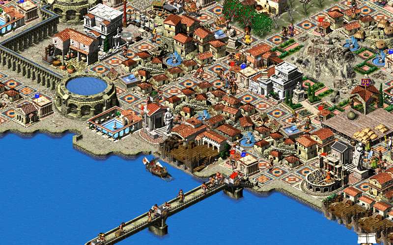
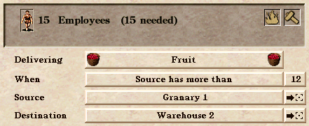
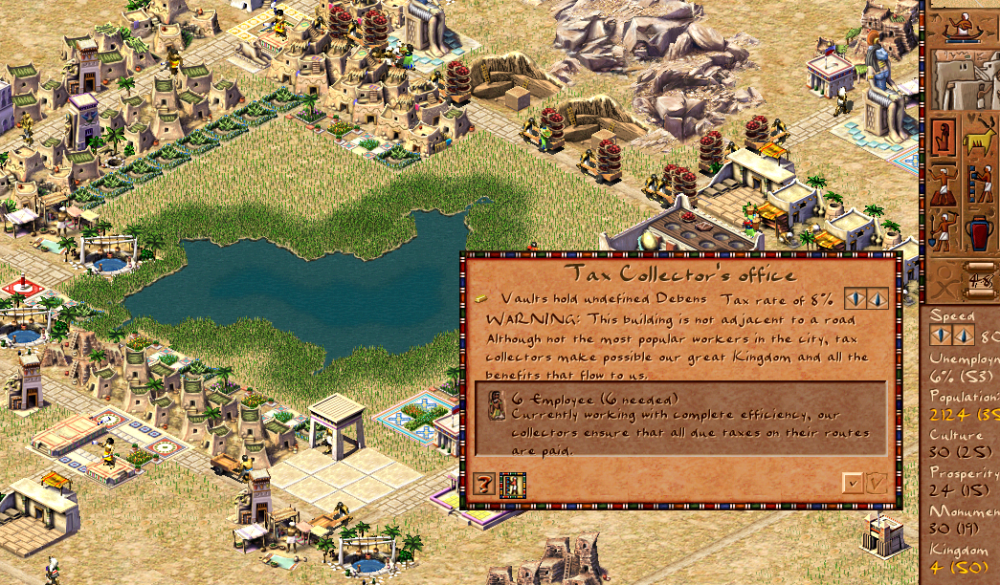

# 누르면 보이는 마을: 시저·파라오 조사와 적용 기획

조사일: 2026-11-01. 대상 버전: 현재 게임 `6c2aa70`의 `frontier.html`과 `js/valley-*.js`.

[스크린샷과 클릭 가능한 시안](../research/caesar-village/index.html) · [현재 게임](../frontier.html)

## 결론

최신 방향은 [전략·전술 개입 기획](strategy-intervention.md)을 따른다. **마을은 건물 위치·건설·작업 배정을 자동으로 정하고, 플레이어는 장기 방향과 위기 대응을 선택한다.** 건물·주민 카드는 그 판단의 근거를 알아보는 관찰 기능이다.

핵심 흐름은 **자동 생활 → 변화 확인 → 전략·전술 선택 → 자동 실행 → 실제 결과 관찰**이다. **밭 → 일하는 주민 → 운반하는 짐 → 마을 창고 → 식사**는 궁금할 때 눌러 보는 흐름으로 둔다. 건물 배치·개별 작업 지시·주민 카드 순회를 필수 플레이로 만들지 않는다. 전체 개인 모델의 완성보다 기존 첫겨울 전략의 선택·실행·결과 연결을 먼저 진행한다.

이번 산출물은 조사·기획·독립된 UI 시안이다. 게임의 경제·인구·저장·그래픽 선택 처리를 수정하지 않았다. 시안의 이름, 수치, 상태, 표시 경로는 가상의 예시다. 실제 플레이 화면과 혼동하지 않도록 시안 안과 위에 표시했다.

## 실제 자료에서 확인한 것

직접 플레이 검증은 하지 않았다. 아래 공개 프로젝트의 문서, 실제 스크린샷, UI 처리 코드를 확인했다. 기본 시저 III와 확장 프로젝트의 기능을 구분한다.

| 참고 대상 | 확인한 사실 | 우리 게임에 적용하려는 제안 |
|---|---|---|
| 시저 III의 원작 경험을 보존하는 Julius | 농장 정보창이 생산 진행률, 필요·현재 일꾼, 길 접근·중단 상태에 따라 다른 설명을 표시. 운반 인물 창은 이름·직업·자원 아이콘과 출발·목적 건물 연결을 표시 | 건물 역할 한 줄 + 현재 상태 + 실제 일하는 주민. 운반 중인 사람과 목적지를 서로 선택 |
| Augustus 4.0, 시저 III의 커뮤니티 확장 | 운송소 창에서 직원 수·물품·운송 조건·출발지·목적지를 확인하고 대상 건물로 이동. 이동 경로 미리보기, 창고·생산 효율 등의 지도 표시 | 물자의 단계별 수량과 실제 이동 경로. 경로는 선택한 한 대상만 표시 |
| 원작 파라오의 재구현 Akhenaten | 공개 세금 징수소 창에 역할 설명, 직원 6명/필요 6명, 길에 닿지 않는다는 경고가 함께 나타남 | 문제 한 줄 + 관련 현장으로 이동. 정상·경고 문장의 모순을 피하고 실제 막힌 이유를 우선 표시 |

Julius의 이동 인물 정보가 있다는 사실을 ‘모든 인구가 고유한 평생 개인 기록을 가진다’는 주장으로 확장하지 않는다. Akhenaten은 `Pharaoh: A New Era`와 다른 프로젝트다. Augustus의 운송소·경로 미리보기 등을 시저 III 원판 기능으로 소개하지 않는다.

### 스크린샷

**참고 게임의 실제 공개 화면**

출처: [Julius README](https://github.com/bvschaik/julius), [원본 이미지](https://github.com/bvschaik/julius/blob/34d1ecd54befb845c0139b371fa8a0438210dac1/res/vita/bg.png). 역할별 건물, 길과 이동 인물이 같은 지도에 놓여 있다. 정보창 동작은 아래 UI 코드로 별도 확인했다.

출처: [Augustus 4.0 매뉴얼](https://github.com/Keriew/augustus/blob/c0b2a5aefcd8f12331aad028002f101bf8c22417/res/manual/augustus_manual_en_4_0.pdf), **PDF 10쪽**(인쇄 쪽수 9). PDF에 포함된 실제 이미지를 추출했다. 출발지와 목적지 오른쪽에는 해당 건물을 찾는 버튼이 있다.

출처: [Akhenaten 공개 스크린샷 목록](https://github.com/dalerank/Akhenaten/blob/0e5ea57f84819106b19e378039b3bf903966c4cf/docs/screenshots.html), [원본 이미지](https://github.com/dalerank/Akhenaten/blob/0e5ea57f84819106b19e378039b3bf903966c4cf/docs/images/tax-collector-window.png). 이 화면의 경고는 해당 참고 게임의 상황이다. 현재 우리 게임의 밭·작업조에 도로 연결 규칙이 있다고 설명하는 근거로 쓰지 않는다.

이미지의 권리는 각 권리자에게 있다. 분석을 위한 인용이며 게임 에셋으로 쓰지 않는다. 원본 그림을 다시 그리거나 번역된 정보창인 것처럼 조작하지 않았다.

### 문서·코드 출처

- [Julius README](https://github.com/bvschaik/julius/blob/34d1ecd54befb845c0139b371fa8a0438210dac1/README.md): 원작 경험 보존이라는 프로젝트 방향.
- [농장 정보 표시](https://github.com/bvschaik/julius/blob/34d1ecd54befb845c0139b371fa8a0438210dac1/src/window/building/industry.c#L15-L53): 생산 진행률, 도로 접근, 조업 중단, 인원별 설명, 고용 표시.
- [운반 인물 표시](https://github.com/bvschaik/julius/blob/34d1ecd54befb845c0139b371fa8a0438210dac1/src/window/building/figures.c#L227-L279): 이름·직업·자원 아이콘, 출발·목적 건물.
- [주택 정보 표시](https://github.com/bvschaik/julius/blob/34d1ecd54befb845c0139b371fa8a0438210dac1/src/window/building/house.c): 주택·주민·공급·발전 설명의 연결.
- [Augustus README](https://github.com/Keriew/augustus/blob/c0b2a5aefcd8f12331aad028002f101bf8c22417/README.md): Julius에서 파생된 게임 개선·추가 프로젝트. 원작 충실 경험은 Julius를 권장.
- [Augustus 4.0 매뉴얼](https://github.com/Keriew/augustus/blob/c0b2a5aefcd8f12331aad028002f101bf8c22417/res/manual/augustus_manual_en_4_0.pdf): PDF 6쪽 경로 미리보기, 10쪽 운송소, 11–12쪽 시장·창고 주문, 17쪽 지도 표시. 인쇄 쪽수는 각각 한 쪽 적다. 2023년 12월 매뉴얼에 대한 확인이며 최신 버전 전체 기능 평가가 아니다.
- [Akhenaten README](https://github.com/dalerank/Akhenaten/blob/0e5ea57f84819106b19e378039b3bf903966c4cf/README.md): 원작 파라오 재구현이라는 프로젝트 설명. 스크린샷 목록은 위 참조.

## 현재 게임을 확인한 결과

### 지금 있는 것

- 우리 마을은 인구 12명의 작은 정착지로 시작하며 다른 마을과 세력도 자동으로 돌아간다.
- 작업조가 수확하고, 짐을 들고 중앙 적재 장소로 돌아오면 재고가 증가한다. `workers[].phase`, `cargo`, `job`, `work`는 실제 작업 상태다.
- `pop`, `ledger`, 마을별 재고와 건설 자재·진행률, 교역 수레, 조공 처리 기록이 있다.
- 첫겨울, 잠자리 부족, 마을 방향 선택과 외교 결과를 확인하는 UI가 있다.

### 요구와 맞지 않는 부분

1. **건물을 직접 선택할 수 없다.** 주로 마을 이름표를 선택한다. 건물 그래픽은 묶어서 그리며 개별 건물 번호와 선택 결과 연결이 없다.
2. **주민 12명의 개인 기록이 없다.** 지도 인물 6개는 고정된 작업조 6개다. 노동량은 인구의 약 절반을 작업조로 나누어 계산한다. 각 인물을 주민 한 명으로 이름만 붙이면 인구·이주·짐 기록과 충돌한다.
3. **특정 건물과 특정 일꾼이 연결되지 않는다.** 밭이 여러 개여도 마을 합산 생산에 영향을 주고 작업 위치는 고정된 상대 좌표를 사용한다. 건물별 생산·고용 수치를 UI에서 임의로 나눠선 안 된다.
4. **집은 잠자리 합계다.** 집 한 채는 6자리를 늘리지만 누가 어느 집에서 자는지는 기록하지 않는다.
5. **별도 창고 건물이 없다.** 마을 중앙의 적재 위치와 공용 재고가 있다. 우선 여기를 ‘마을 창고’로 선택하게 한다. 현재 식사는 공용 재고에서 인구별로 소비하며 집마다 배달하지 않는다.
6. **이름과 실제 기능이 어긋나는 곳이 있다.** ‘목공 작업장’은 나무뿐 아니라 돌 생산도 높인다. 시장은 현재 무역의 필수 조건이 아니다. 실제 기능과 설명부터 맞춰야 한다.

### 현재 효과에 맞춘 건물 설명

| 대상 | 쉬운 역할 문장 | 데이터 표시 원칙 |
|---|---|---|
| 공동 농장 | 먹을 곡물을 기르는 곳 | 밭 존재·개수와 실제 수확 처리에 연결. 건물별 기록 전에는 마을 전체 수확과 구분 |
| 주택 | 주민이 잠자는 곳 | 한 채 6자리. 거주 배정 구현 후 실제 거주자 표시 |
| 중앙 적재 장소 | 가져온 물건을 함께 모으는 곳 | 공용 식량·나무·돌, 실제 도착과 소비 기록 |
| 작업장 | 나무와 돌을 더 잘 다듬는 곳 | 현재 시설 하나당 나무·돌 생산 계수에 +0.15. 무조건 최종 생산량 15% 증가로 단순 설명하지 않음 |
| 방앗간 | 먹거리 생산과 보관을 돕는 곳 | 식량 생산 계수에 +0.15, 보관 한도 +80. 가상의 밀가루 가공 체계를 설명하지 않음 |
| 교역 시장 | 다른 마을과 물건을 주고받는 창구 | 우선 실제 교역·수레를 확인하는 진입점. 필수 조건·추가 수익 효과는 현재 없음. 효과를 추가하려면 별도 경제 변경 필요 |

## 화면 설계 제안

### 기본 지도

지도를 가득 사용한다. 상시 정보는 시간, 우리 주민 수, 현재 재고로 먹을 수 있는 날수, 잠자리만 유지한다. 세력 지도·기록·설정은 필요할 때 연다. 다른 마을 이름표와 모든 건물 상태를 동시에 켜지 않는다.

선택하면 건물 바닥과 관련 경로만 강조한다. 화면 오른쪽 정보창 하나(모바일 아래쪽 창)를 열고 다른 창을 중첩하지 않는다. 기본 정보는 역할 한 문장, 현재 상태 한 줄, 관련 사람·물자, 이동 버튼이다. 긴 과거 기록은 펼쳐 보기로 둔다.

PC는 건물 클릭, 터치는 넓힌 선택 범위로 건물 선택. 가까운 대상이 겹치면 작은 선택 목록을 띄운다. 드래그·핀치 이후에는 선택하지 않는다. 먼 거리의 작은 인물을 억지로 누르게 하지 않고 집·일터 카드에서도 주민을 고른다. 지도 키보드 탐색용으로 주민·건물 목록 진입점도 둔다.

### 건물 카드

예시: `🌾 강변 밭 / 먹을 곡물을 기르는 곳 / 2명 일하는 중 / 오늘 수확 4.8 = 창고 도착 1.8 + 운반 중 3`.

- 수확량과 창고 도착량을 구분한다. 동일한 물자를 더해서 총 생산으로 세지 않는다.
- 두 숫자에 기준 시각·기간을 붙인다. 수확의 일별 흐름과 현재 창고 잔량을 섞지 않는다.
- 실제 배정한 사람만 나열한다. 현역 일꾼이 없는 집·시장·방앗간에는 가짜 직원을 만들지 않는다.
- 문제는 현재 처리를 막는 조건 하나를 먼저 보여준다. `집을 지을 나무가 8개 모자라요 → 나무 운반 현장`처럼 위치로 연결한다.
- 현재 건물 상태·소속과 자원 소유자가 분명해야 한다. 다른 마을의 재고를 우리 재고처럼 표시하지 않는다.

### 주민 카드

모든 실제 주민이 고유한 카드를 갖는 것이 목표다. 기본은 이름, 현재 행동, 현재 짐, 집, 일터, 따라가기다. 이름만 다른 복제 작업조 카드로 처리하지 않는다. 가족·나이·감정·유년기 등 별도 시뮬레이션이 없는 항목은 추가하지 않는다.

- 지도 인물, 건물 직원, 집 거주자, 주민 목록은 같은 주민 번호를 참조한다.
- 개별 명령을 요구하지 않는다. 자동 배정 후 바뀐 행동을 관찰한다.
- 쉬는 주민도 카드가 있다. 아직 수면·휴식 상태를 계산하지 않는 구현 단계에서는 가상의 수면 시간표를 쓰지 않는다.
- 주민이 이주하면 번호와 개인 기록을 함께 옮긴다. 원래 집 카드는 빈 자리로 갱신한다. 사망 기록과 현재 생존 목록을 구분한다.
- 이전 저장에 개인 기록이 없으면 이행한 날부터 기록한다. 이름 등 신규 식별 정보의 부여와 과거 생애 기록을 구분하고, 과거의 가족·이주·직업을 지어내지 않는다.
- 이웃 마을도 최종적으로 같은 카드 체계를 쓴다. 첫 구현 범위만 우리 마을로 제한하며 세계 전체 적용 전까지 외부 작업조를 개인이라고 부르지 않는다.

### 먹거리 보기

`🌾 수확 → 🚶 운반 → ▣ 창고 → 🍲 식사`의 네 단계. 각 단계를 누르면 해당 건물이나 운반자를 선택한다. 단계가 멈춘 경우 실제 이유만 표시한다. 집까지 이어지는 가상 배달선을 그리지 않는다.

현재 재고의 변화는 `시작 재고 + 운반 도착 + 외부 도착 − 식사 − 외부 발송 − 실제 손실 = 끝 재고`로 맞춘다. 수확했지만 운반 중인 식량은 창고 유입에 넣지 않는다. 생산 지원·조공·약탈·군대 보급 등 기존 차감 경로는 실제 코드를 조사해 빠짐없이 분류한다. 기록이 없는 과거 기간은 원인을 추정하지 않는다.

교역은 이후 같은 표시 언어로 이어진다. `우리 나무 → 수레 → 이웃 / 이웃 곡물 → 수레 → 우리 창고`. 보호는 `실제 수확 중 12% → 보호 세력`, 필요한 경우 `지원 곡물 → 우리 마을`. 세계 모든 선을 항상 켜지 않는다. 협정이 없는 상대에게 오는 짐이 있는 것처럼 표시하지 않는다.

### 쉬운 말

| 기존 용어 | 먼저 보여줄 문장 |
|---|---|
| 비축 18일 | 지금 있는 먹을 것으로 18일 |
| 순증감 −2 | 오늘 먹은 양이 들어온 양보다 2개 많아요 |
| 조공 12% | 수확 100개 중 12개를 보내고 보호받아요 |
| 경작권 분쟁 | 두 마을이 이 밭을 쓰겠다고 다투고 있어요 |
| 동원 | 일하던 주민이 싸우러 가요 |
| 시설 상태 62% | 건물이 낡았어요 + 실제 수리 재료·영향 |

‘몇 일분’은 현재 인구의 하루 식사량으로 나눈 현재 재고다. 앞으로 들어올 수확·수레를 보장하는 예측으로 부르지 않는다. 시설·지배·전쟁의 복잡한 내역은 사용자가 펼쳤을 때만 자세한 숫자를 보여준다.

### 글을 읽기 전에 보일 변화

- 수확 중인 사람은 밭에서 작업 동작을 하고, 운반할 때는 실제 자원에 맞는 짐을 든다. 배회·운반·현장 작업이 같은 서 있는 모습으로 보이지 않게 한다.
- 선택한 주민의 발밑과 실제 목적지만 표시한다. 모든 주민에게 말풍선이나 이름표를 상시 붙이지 않는다.
- 중앙 적재 장소의 자루·나무 더미는 실제 재고 구간에 맞춰 늘고 줄어든다. 그래픽 구간을 바꾸었을 뿐 정확한 재고를 계산한 것처럼 과장하지 않는다.
- 집의 남는 잠자리는 침대 그림으로 보여준다. 공사 중·완공·빈집·폐허는 실제 건물 상태로 구분한다. 사람이 모자란 것과 자재가 모자란 것은 다른 표식을 쓴다.
- 교역 수레를 선택하면 줄 물건·받을 물건과 실제 도착 상태가 연결된다. 지원이 출발하지 않았는데 오는 수레를 장식으로 만들어 보여주지 않는다.

### 관찰의 재미를 확인할 장면

첫 목표는 성장 숫자를 늘리는 것이 아니라 **‘아까 보던 사람이 물건을 가져와서 마을이 달라졌다’는 장면**이다. 밭에서 본 하린이 창고로 들어오고, 재고가 늘고, 준비하던 집이 완공되면 그 집 카드에서 거주자를 다시 찾는다. 이 일련의 변화가 실제 기록으로 연결되어야 한다.

먹거리가 줄 때는 생산 부족·운반 미도착·외부 반출 중 실제 원인을 찾아 다음 결과를 예상하게 한다. 전쟁이나 동원으로 일손이 줄었음을 설명하려면 실제 배치와 생산 변화 기록부터 연결한다. 단지 긴장감을 만들려고 운반 지연·굶주림·전쟁을 임의로 추가하지 않는다. 첫 사용자에게 이름 하나를 기억하는지, 식량 감소 이유를 찾는지, 스스로 시간을 더 보내 보는지 관찰한다.

## 관찰 보조 기능의 구현 순서와 검증

아래는 건물·주민 관찰을 구현할 때의 의존 순서다. 전체 게임 개발은 [전략·전술 개입 기획의 우선순위](strategy-intervention.md#개발-우선순위)를 먼저 따른다.

### 1. 건물 선택과 실제 역할

`buildings[]`에 저장 가능한 고유 번호를 추가한다. 수리·빈집·폐허 상태 변경 후에도 같은 번호를 유지한다. 렌더러의 인스턴스 번호를 마을·건물 번호에 연결한다. 거리별로 그래픽을 다시 묶었을 때도 선택 대상이 바뀌지 않아야 한다. 선택은 시뮬레이션 난수·경제에 영향을 주지 않는다.

가까운 건물 선택, 카드 닫기·다른 대상 선택·카메라 이동, 드래그 후 오선택 방지, PC·터치·키보드 검증. 역할과 현재 실제 효과, 건설 진행·재료 부족부터 연결한다. 이 단계의 기존 인물은 정직하게 ‘작업조’라고 쓴다.

### 2. 실제 개인 기록과 집·일터

인구 수와 주민 기록 수가 일치하는 원본 모델을 먼저 만든다. `residentId`, 소속 마을, 현재 집, 일 배정, 짐·작업 상태를 실제로 연결한다. 집 배정은 6자리와 실제 인원수에 맞춘다. 임시 거처도 별도 위치로 표시한다.

현행 작업조 생산량은 인구와 배치된 병력·마을 상태에 의해 달라진다. 여기에 개인 12명을 단순 추가하면 노동과 짐이 두 번 계산될 수 있다. 노동 가능량의 총합을 현행 계산과 맞추고, 이전 작업조의 진행 중 짐은 한 번만 이전한다. 개인과 작업조가 같은 자원을 중복 생산하지 않게 한다. 주민별 업무 선택을 무작위로 매 프레임 재추첨하지 않는다.

이주·출생·사망·전쟁·피란 이동의 처리에서 개인 기록을 같이 변경한다. 도입 이전 출생·이주 장부를 가상의 개인 과거로 분배하지 않는다. 우리 마을부터 적용하되 외부 인구 이동 시 식별자 보존 방식도 이 단계에서 정한다. 이전 저장을 위한 이행과 상태 버전 검증을 함께 한다.

검증: 생존 주민 수 = 마을 인구, 중복 주민 번호 없음, 동시 두 집·두 마을 소속 없음, 잠자리 한도, 짐 보존, 저장 후 같은 인물 복원, 카드를 열어도 난수·경제 동일. 남은 주민이 떠나 빈 마을이 되어도 카드는 잘못된 대상을 가리키지 않아야 한다.

### 3. 실제 생산·운반·소비 기록과 그림

일꾼의 실제 작업 대상을 건물 번호에 배정하고, 수확·짐 생성·도착·소비 처리에서 원인을 남긴다. 현재 마을 전체 생산량을 건물 수로 나눠서 각 밭 생산량인 척하지 않는다. 밭이 여러 개일 때 실제 작업 위치와 생산 귀속을 정한 뒤 건물별 수치를 표시한다.

운반자 번호와 짐의 출발·목적지를 기록한다. 그림, 카드 숫자, 일별 자원 변화는 같은 기록을 읽는다. 이동선은 장식용 직선 대신 실제 현재 이동 위치와 목적지에 맞춘다. 취소된 공사 짐, 건물 파괴, 작업 변경·이주 시 목적지가 유효한지 처리한다. 없는 도로 규칙을 ‘길이 막혔다’고 표시하지 않는다.

검증: 단계별 같은 물자를 중복 계산하지 않음, 시작/끝 재고 등식, 실제 수확 4.8 중 1.8 도착+3 운반 사례, 건설·식사·조공·교역 차감과 일별 기록 일치, 기록이 없는 과거 구간의 빈 표시, 일시정지 시 수치와 경로 고정.

### 4. 다른 마을과 오래된 세계

같은 주민·건물 모델을 다른 마을로 확장한다. 인구가 커도 카드 선택으로 경제를 다시 계산하지 않는다. 멀리 있는 주민 표시 수를 줄여도 실제 주민 기록을 삭제하지 않는다. 선택하지 않은 마을의 개인 화면은 매 프레임 만들지 않는다.

검증: 다른 마을 카드의 소유자와 실제 재고, 세계 주민 수와 인구 합계, 세력 변화 후에도 남는 번호, 멸망·이주 후 소속, 초기·오래 진행한 저장의 모바일 응답. 변경에 맞는 기존 `tests/valley*.cjs`, `tests/winter.cjs`, 주민 움직임·모바일 UI·렌더 예산 검증을 실행한다. 성능 테스트는 다른 CPU 집약 테스트와 동시에 실행하지 않는다. 측정 전에는 성능 개선을 선언하지 않는다.

## 첫 5분의 목표 경험

1. 주민 12명의 작은 마을과 자동으로 살아가는 이웃을 본다. 건물 위치와 작업은 마을이 정한다.
2. 먹거리·주거 상황과 자급·교역·보호의 실제 비용·대가를 확인한다.
3. 마을의 방향을 정하거나 AI에 맡긴다. 궁금하면 건물·주민을 눌러 근거를 더 살펴본다.
4. 자동 배정·건설·수레 출발을 보고 시간을 보낸다.
5. 실제 비축·잠자리·수입·조공의 변화를 보고 방침을 유지할지 바꿀지 판단한다.

이는 목표 경험이며 현재 달성했다는 주장이 아니다. 실제 첫 사용자 관찰로 검증한다.

## UI 시안의 범위와 촬영 조건

- [독립 시안](../research/caesar-village/index.html): 밭, 주민 12명 전원, 집·텐트, 창고, 먹거리 흐름을 클릭해 볼 수 있다. 지도 인물 추적 버튼은 실제 카메라 추적이 연결될 자리를 설명한다. 경로 재생은 선 표시만 재생하며 경제나 실제 주민 이동을 계산하지 않는다. 게임 저장을 읽거나 쓰지 않는다.
- 배경 `images/our-map.png`: 실제 `frontier.html?seed=7341`, 격리된 새 브라우저 저장, 자립 선택, 180일 진행 호출 후 촬영. 실제 촬영 시각은 세계 363일, 시작 세계 180일에서 183일 경과. 인구 12명, 중앙 건물·밭·집 각 하나. 시간 일시정지, 우리 마을 확대, 기존 HUD·이름표를 숨겨 지도만 촬영. 게임 파일은 수정하지 않았다.
- 시안의 주민 이름·창고 48개·밭 생산 4.8 등의 값은 위 실제 저장에서 가져온 값이 아니다. 첫겨울을 보낸 실제 지도 위에 놓은 향후 UI 예시다. 예시에서는 4.8 = 1.8 + 3, 48 ÷ (12×0.2) = 20일, 집 6명+텐트 6명 = 12명으로 표시를 맞췄다.
- [건물 카드 시안](../research/caesar-village/images/proposal-building.png), [주민 카드 시안](../research/caesar-village/images/proposal-resident.png), [먹거리 흐름 시안](../research/caesar-village/images/proposal-food.png), [모바일 시안](../research/caesar-village/images/proposal-mobile.png): 브라우저에서 렌더링한 시안의 촬영본. 실제 출시 기능 스크린샷과 구분한다.

시안 검증: Chromium에서 1440×1000, 390×844 화면으로 주민 12명 카드, 집·밭·창고·먹거리 이동, 창 닫기·재열기를 확인했다. 브라우저 오류·로딩 실패·가로 넘침이 없고 게임 저장 접근이 없다. 최종 모바일 밭 정보창은 핵심 정보를 내부 스크롤 없이 표시한다. HTML 내부 이미지·스크립트·스타일 경로와 연결 문서 존재, 자바스크립트 문법, 공백 오류를 확인했다. 실제 게임 변경이 없으므로 게임 시뮬레이션 성능이나 개인 모델 구현을 검증한 결과로 해석하지 않는다.

## 완료 기준

건물 용도, 주민의 현재 행동, 먹거리 감소 원인을 각각 두 번 이내의 클릭으로 찾는다. 집·일터·짐과 카드가 같은 번호를 가리킨다. 주민 수와 개인 기록 수, 자원 변화와 기록 합계가 맞는다. 저장 후 같은 사람을 다시 찾는다. 정보창을 닫으면 지도가 다시 중심이 된다. 기존 자동 시뮬레이션을 보기 위해 주민별 작업 명령을 요구하지 않는다.
