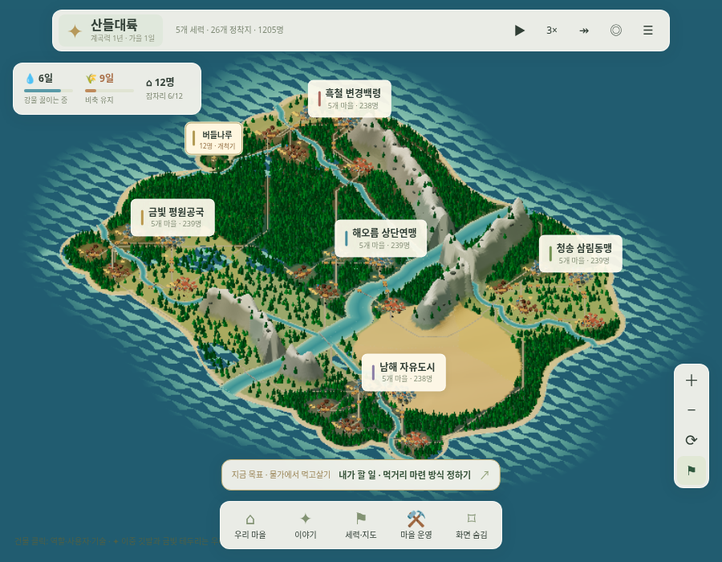
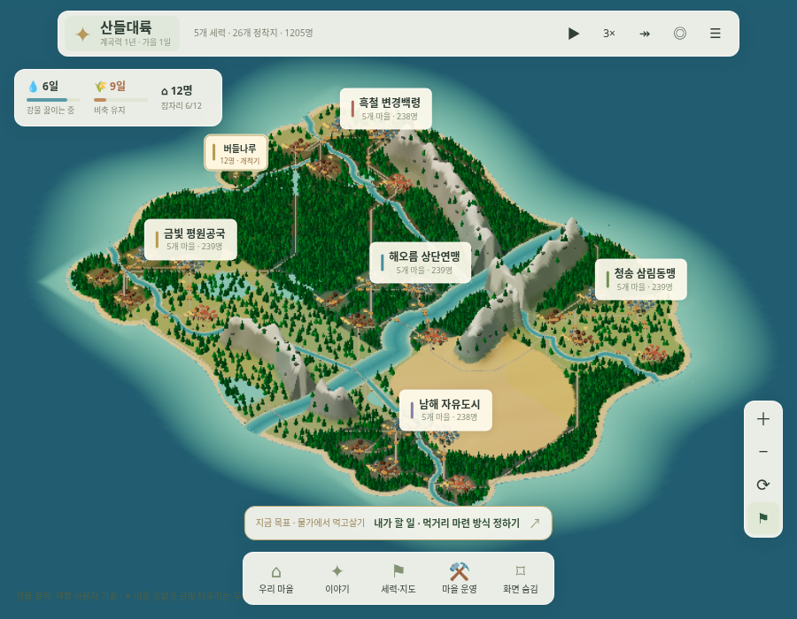
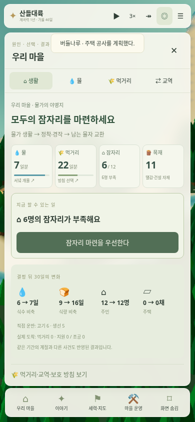

# 화면 이동의 깜빡임과 직접 플레이한 평가

2026-11-01 · [실행](https://kkhkkh20-bit.github.io/everworld-game/frontier.html?campaign=survival&v=15) · [검사와 플레이 관찰 기록](camera-stability-review.json)

현재라면 오래 붙잡고 플레이할 게임이라고 평가하지 않는다. 관리자가 고른 방침이 주민의 생활과 눈에 보이는 변화로 돌아오는 경험이 아직 약하다. 이 평가는 외부 사용자 조사나 재미를 정량 측정한 결과가 아니라, 실제 신규 원정에서 먹거리 방침과 시간 진행을 조작해 본 개발자의 평가다.

## 이동할 때 수면이 깜빡인 원인

연안의 색을 가진 수면 바로 밑에 넓은 바다 평면이 겹쳐 있었다. 카메라를 움직이면 두 표면이 번갈아 나타나며 수면에 삼각형 무늬가 떨렸다. 진단 중 아래쪽 평면만 숨겨 무늬가 사라지는 것을 확인했다.

연안 그리드는 유지하고, 먼 바다는 그 바깥을 둘러싸는 테두리 메시로 바꿨다. 같은 지점에 두 바다 표면을 겹치지 않는다. 경계 높이도 같고 바깥 바다의 범위와 색은 유지한다. 수면 생성은 `valley-scene-ocean.js`로 분리했다. 지형·물 수급·길·경제·저장은 바꾸지 않았다.

정지한 기본 씨앗 7341의 전체 지도에서 카메라를 x축으로 0.11씩 옮기며 18프레임을 그렸다. 바다의 고정된 세계 좌표 401곳을 매번 화면 좌표로 다시 투영해 색을 읽었다. 같은 지점의 RGB 채널 범위가 12를 넘으면 큰 변화로 셌다. 카메라와 정적인 조명만으로는 그 바다 지점의 색이 뒤집힐 이유가 없다.

| 조건 | 큰 색 변화가 있었던 지점 |
|---|---:|
| 수정 전 · 900×700 | 278 / 401 · 약 69% |
| 수정 후 · 900×700 | 0 / 401 |
| 수정 후 · 390×844 | 4 / 401 · 약 1% |

Chromium 154·SwiftShader에서 검사했다. 수정 전 소스는 `bb0d3ee`에서 읽었고, 같은 검사에서 실제로 실패함을 확인했다. 수정 후에는 연안·먼 바다 네 지점에 수직 광선을 쏴 바다 표면이 각각 정확히 한 번만 만나는 것도 검사했다. 경제·난수·저장 상태가 관찰 전후 같고 GL 오류가 없음을 확인했다. 실제 드래그·휠 확대·전체 지도와 마을 전환도 연속 촬영해 확인했다.

이 수치는 FPS나 모든 기기에서 깜빡임이 완전히 없어졌다는 보장이 아니다. 고정된 세계 좌표의 수면 안정성을 검사한 결과다. 나무의 세부 전환이나 작은 물체의 윤곽 계단 현상까지 없앴다고 주장하지 않는다. 배경 캐시의 밝은 조명 아래 색·가림과 프레임 간 복원 검사도 유지했다.

## 신규 사용자로 눌러 본 결과

새 원정에서 먹거리 창을 열고 농사 방침을 정한 뒤, ‘다음 변화’를 6번 눌렀다. 수정 전 관찰에서는 180일에서 189일까지 **9일만 진행**했다. 6번 중 4번은 우리 마을 사건이 하나도 없는데도 다른 마을의 거래 등으로 멈췄다. 첫 농장과 집을 기다리는 사람에게 다음 변화 버튼이 제 역할을 하지 못했다.

가까운 화면에서는 선택한 마을의 실제 수확·건설·물자 도착·위기·출생·30일 결과 등에 멈추고, 먼 전체 지도에서는 전쟁·보호 관계·영토·기후 같은 큰 변화에 멈추도록 바꿨다. 멈춘 이유는 이미 발생한 사건으로 짧게 알린다. 실제 엔진으로 최대 35일을 진행하며, 직접 답변이 필요한 제안이 오면 그대로 멈춘다. 결과나 사건을 새로 생성해 보여주는 기능은 아니다.

수정 후 같은 여섯 번 조작을 한 관찰에서는 225일까지 45일을 진행하며 다음 변화를 봤다.

1. 첫 열매가 실제로 창고에 도착했다.
2. 첫 생선과 고기가 도착했다.
3. 농장이 완성돼 첫 수확이 시작됐다.
4. 곡물이 도착했다.
5. 선택 뒤 30일의 식량·주민 변화가 기록됐다.
6. 주택 공사를 계획했다.

자동 UI 회귀 검사에서는 같은 경로로 여섯 번 눌러 우리 마을의 실제 사건, 정지 상태 유지와 30일 결과 도달을 확인한다. 브라우저에서 선택한 순간의 초기 진행량에 따라 세부 날짜가 달라질 수 있으므로 정확히 같은 날짜만 검사하지 않는다.

## 아직 재미가 약한 부분

첫 45일을 봐도 주민은 12명이고 집은 완성 전이다. 수확과 비축 변화는 있지만 기다림에 비해 마을의 외형 변화와 주민의 반응이 적다. 선택 뒤 30일 표도 실제 결과를 알려주지만, 화면만 봐서 ‘내 결정 덕분에 살림이 나아졌다’고 느끼는 보상은 부족하다.

농사·주거·교역·보호 조건은 있지만 초반에는 자재가 부족해 여러 선택이 사실상 기다리기로 돌아온다. 발전한 이웃의 역사·군사 숫자를 읽는 것만으로는 그 나라와 관계를 맺고 싶어지기 어렵다. 거래 한 번이 우리 주민의 생활을 어떻게 바꿨는지까지 드러나야 한다.

후속 개선의 우선순위는 실제 첫 집 완성, 첫 왕복 거래, 첫 외교 요구를 화면에서 이해하고 다음 결정을 기대하게 하는 것이다. 더 많은 시스템을 동시에 붙이기보다 이 짧은 구간의 관찰·선택·결과를 다듬어야 한다. 이 문단은 평가와 다음 방향이며 이번에 새 사건이나 주민 감정 시스템을 구현했다는 뜻은 아니다.

검증: `tests/valley-camera-stability.cjs`, `tests/scene-depth-cache.cjs`, `tests/valley-observation.mjs`, `tests/valley-observation-ui.cjs`, PC·모바일 `tests/valley-ui.cjs`·`tests/frontier-economy-ui.cjs`, `tests/render-budget.cjs`, 10개 씨앗 `tests/simulate.mjs`.
