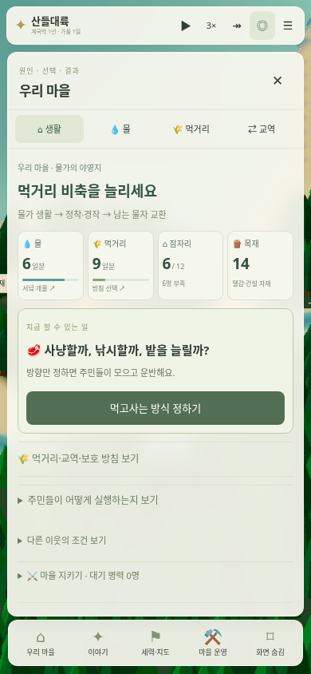
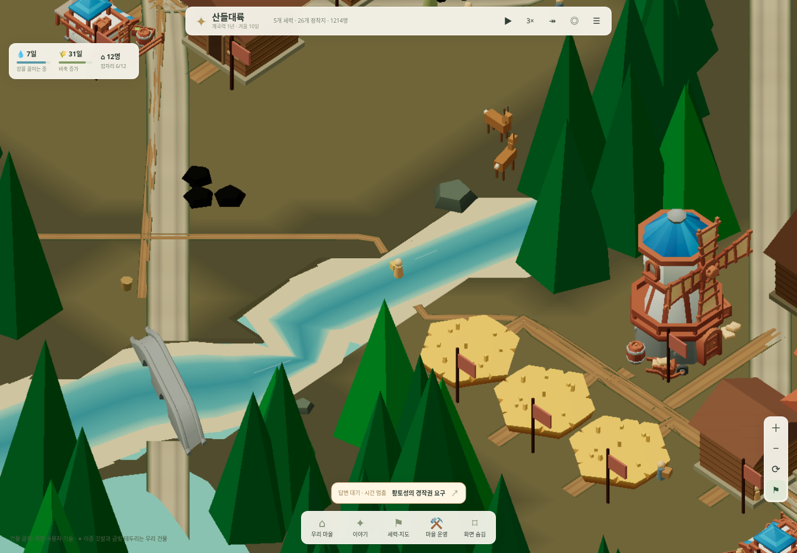
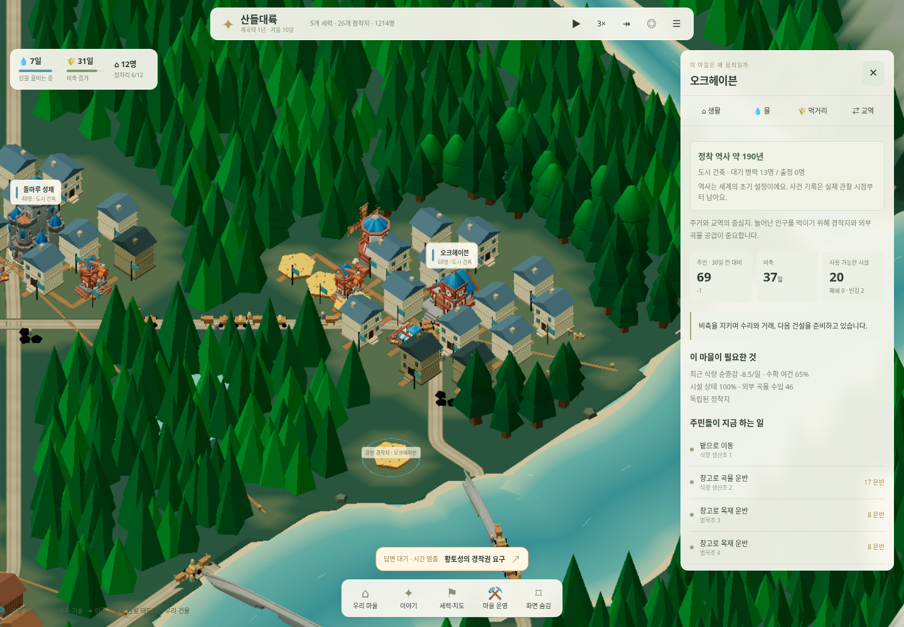

# 자급한 뒤, 길과 군사력에 투자하는 마을

2026-11-01 · [새 생존 원정 실행](https://kkhkkh20-bit.github.io/everworld-game/frontier.html?campaign=survival&v=13)

초기 우리 마을은 대륙 구석의 초가 공동체 12명이다. 기술은 개척기, 교역로와 보호자·훈련병은 없다. 물·먹거리·잠자리를 확보하는 동안 주민들은 생산·운반·건설을 자동으로 결정한다. 관리자는 무엇을 우선할지, 누구와 어떤 조건으로 거래할지, 자재를 건물·길·방위 중 어디에 쓸지 결정한다.

생활 → 먹거리에서 사냥·낚시·농경 방향을 정한다. 주변 물을 끓이는 땔감과 생활 자재도 필요하다. 거래 물자가 도착하기 전까지 자급해야 하며, 보호를 받더라도 조공과 운송의 부담은 사라지지 않는다.

## 사람부터 다니는 교역

첫 접촉에는 정찰 식량 5와 한 작업조의 생산 기회가 든다. 지형을 따라 정찰을 마치면 도보로 연결한다. 길을 깔지 않아도 짐을 멜 수 있지만, 처음부터 수레 물량을 나르지는 못한다.

| 길 단계 | 필요한 기술 | 최대 운반량 | 이동 속도 | 운송 인원 |
|---|---|---:|---:|---:|
| 도보 오솔길 | 개척기 | 8 | 2.8 / 일 | 짐 4당 1명, 최대 2명 |
| 다진 흙길 | 목조 | 24 | 4 / 일 | 손수레 1명 |
| 자갈 수레길 | 석조 | 60 | 5 / 일 | 달구지 1명 |
| 포장 대로 | 도시 | 90 | 6 / 일 | 달구지 1명 |

발송 마을의 기술과 경로에서 가장 낮은 길 단계가 한도를 정한다. 경로가 길거나 상태가 나쁘면 발전한 도시의 물자도 적게, 늦게 도착한다. 왕복 운송에 발송 마을의 추가 식량을 먼저 지출하고, 돌아올 때까지 운송 인원은 생산에서 빠진다. 한 마을의 운송 인원은 대략 주민의 25%를 넘길 수 없다. 통상 생활 식량은 공동체 장부로 계속 계산하고, 추가 운송 식량은 별도로 기록한다.

좁은 하천의 폭 10 이하 구간은 여울로 도보 통행할 수 있다. 더 큰 강은 도보라도 실제 다리 자재와 공사가 필요하다. 수레길부터는 좁은 하천에도 다리를 놓는다. **이 폭 기준은 게임 규칙이며 수심·유속·홍수에 따른 도하 전체를 모델링한 것은 아니다.**

## 길은 투자다

교역 창에서 각 길의 다음 단계 공사비, 현재 운반 한도, 상태와 비용 회수 추정을 본다. 자재가 없으면 **다른 확장보다 길 자재 먼저 모으기**를 선택한다. 진행 중인 건축은 마치고, 새 생활 기반 외 건설과 여유 있는 때의 계약 목재 수출을 늦춘다. 실제 목재·돌과 식량 14일분, 생활 땔감 여유가 모이면 자동 착공한다. 취소하면 일상 확장으로 돌아간다.

직접 투자할 때는 실제 자재와 식량 14일분이 필요하다. 비용은 착공 때 지불하며 공사 중에는 기존 길의 한도로 다닌다. 한 작업조가 공사에 참여하고, 기간과 실제 접근 이동을 마쳐야 새 단계가 열린다. 길을 직접 배치할 필요는 없다. 왕래만 많다고 무료로 넓어지지 않는다. 기존 교역 계약의 회당 물량·목재 한도는 유지한다. 길이 좋아진 뒤에는 교역 카드에 표시되는 새 물량과 비용을 보고 **계약 변경**을 눌러야 더 큰 운반량을 이용한다.

공사비는 실제 경로 길이 L에 비례하며 단계별 올림을 적용한다. 한 단계씩 높인다.

| 확장 | 목재 | 돌 | 최소 작업일 |
|---|---:|---:|---:|
| 도보 → 흙길 | ceil(L × 0.075) | ceil(L × 0.02) | max(2, ceil(L × 0.07)) |
| 흙길 → 자갈길 | ceil(L × 0.045) | ceil(L × 0.15) | max(2, ceil(L × 0.09)) |
| 자갈길 → 포장 | ceil(L × 0.025) | ceil(L × 0.30) | max(2, ceil(L × 0.12)) |

새 다리는 길이에 비례한 목재·돌·작업일을 추가한다. 이미 있던 다리는 재청구하지 않는다. 흙길은 목재, 높은 단계는 목재와 돌을 날마다 실제 보수비로 쓴다. 장기간 보수를 못 해 상태가 30% 아래로 떨어지면 유효 운반 단계도 내려간다. 기존 국가 역시 실제 교역량·비축·기술·추정 효율을 따져 자재를 지불하고 길을 확장한다.

회수 횟수는 가득 실은 왕복 물량의 추가 식량 절약에서 보수를 빼고, 목재 1.7·돌 2.3의 고정 식량 환산값으로 공사비를 나눈 **운반비 추정**이다. 거래 가격에 따른 순이익이나 확정 수익이 아니다. 실제 수지에는 도착한 식량, 보낸 식량, 추가 운송 식량, 지급 목재·돌을 표시한다. 길 공사·보수와 조공·지원은 별도 장부로 확인한다. 통행 중단과 우회는 실제 도착을 늦추지만 추가 우회 식량을 재청구하는 규칙은 아직 없다.

## 먼저 자리 잡은 주변 국가

다섯 세력의 25개 마을에는 서로 다른 정착 연수와 기술·건물·초기 병력이 있다. 기본 씨앗에서 오크헤이븐은 약 190년, 돌마루 성채는 145년의 배경이며, 시작 기술도 석조·도시 등으로 다르다. 기존 건물은 건설 당시 재료를 유지하므로 기술이 높아도 목조 집이 남을 수 있다. 개축에는 실제 자재와 공사가 든다.

이 연수는 세계의 초기 배경 설정이다. **100년을 미리 시뮬레이션했다는 뜻이 아니다.** 초기 비축·시설도 세계 생성 조건이며, 우리 마을에는 적용하지 않는다. 성채는 원정과 식량 수입을 감당할 초기 비축을 더 갖는다. 이후 모든 국가의 생산·교역·훈련·유지·사망·전쟁은 같은 달력에서 실제 자원과 인구를 바꾼다. 부족한 국가가 항상 전쟁에 성공하지는 않으며, 원정의 식량·병력·예상 이득이 안 되면 철수한다.

생활 창의 **마을 지키기**에서 생존·자급 우선 / 자경대 준비 / 군사력 키우기를 정한다. 목표는 각각 상비 훈련병 0 / 주민 약 10% / 약 20%다. 목표를 바꿔도 병사가 즉시 생기지 않는다.

훈련에는 식량 24일분 이상 여유가 필요하다. 12일 간격으로 주민 한 명을 훈련하며 식량 2, 새 장비에는 목재 1·돌 0.5를 쓴다. 훈련병은 주민 수에 포함되며 새 인구가 아니다. 대기 병력도 식량·장비 보수와 생산 일손 감소를 부담한다. 군비를 줄이거나 보급이 끊기면 점차 일터로 돌아간다. 이웃도 동일하게 훈련과 유지를 지불하고 출정에는 실제 훈련병·보급을 쓴다. 세부 병종과 개인별 병사 생애는 집계 모델에 포함하지 않았다.

## 저장과 검증

`?campaign=survival`은 `everworld_survival_v1`을 사용해 기존 대륙·물가 원정을 덮어쓰지 않는다. 기존 저장을 열 때 시간·재고·건물·운송 중인 물자를 유지하며 필요한 새 장부를 추가한다. 이전 정착 연수나 미기록 공사비를 만들지 않는다. 기존 운송은 원래 짐과 처리 조건으로 끝나고 새 발송부터 운반 한도·추가 비용을 적용한다.

`tests/frontier-economy.cjs`는 실제 도보 접촉, 운반 한도·식량·왕복 인원 복귀·물자 보존, 기술과 비용을 지불한 길 공사·저축 우선순위의 자동 완공, 보수 실패, 실제 훈련비와 결정론적 저장을 검사한다. `tests/frontier-economy-ui.cjs`는 1440px·390px에서 실제 플레이로 발생한 짐꾼과 길·방위·이웃 정보 및 저장 분리를 검증한다. 화면 촬영을 위한 가짜 마을·운송·사건은 만들지 않았다. 900일 세계 검사, 기존 생존·건축·도로·외교·저장 검사와 10개 씨앗 회귀 검사도 유지한다.

## 배경 복원과 이번 성능 측정

브라우저의 서로 다른 프레임에서 지도 배경이 사라지는 오류를 찾았다. 기본 프레임버퍼의 색·깊이를 GPU로 복사하던 경로를 제거하고, 오프스크린 색·깊이를 셰이더로 복원한다. Three.js 내부 프레임버퍼 핸들에도 의존하지 않는다. `tests/scene-depth-cache.cjs`는 프레임 사이를 실제로 기다린 뒤 색과 가림, 앞쪽 인물, 배경 변경과 GL 오류를 검사한다. v12 검사는 같은 자바스크립트 호출 안에서만 연속 렌더해 이 문제를 놓쳤으며, [이전 측정](watershed-performance.md)은 유효한 화면의 개선 근거로 사용할 수 없다.

이번 측정은 CPU 할당량 4코어 상당(스케줄 가능한 CPU 5개), Chromium 154·SwiftShader, 390×844, 브라우저 CPU 4배 제한에서 다른 무거운 검사 없이 단독 실행했다. 현재 규칙의 기본 씨앗과 자급 방침으로 초기 저장 및 추가 900일 저장을 만들었다. [원시 기록](frontier-performance.json)에 실제 카메라·품질·시간·진행량·장면 제출 횟수를 남겼다. 전후 비교가 아니다. 초기 우리 마을은 12명이며, 자급 방침을 바꾸지 않고 진행한 900일 저장의 우리 마을은 폐허가 됐다. 빈 화면의 측정과 구분하기 위해 실제 생존 도시 오크헤이븐 99명도 추가 측정했다. 마을 표본의 확대값은 약 71.5이며, 두 위치와 인구·조건 차이는 원시 기록에서 확인할 수 있다.

| 저장·상황 | 실제 표본 | 실제 진행 | p95 rAF 간격 | 장면 갱신 |
|---|---:|---:|---:|---:|
| 초기 · 정지 전체 지도 | 6.58초 | 0.0일 | 16.8ms | 0회 |
| 초기 · 전체 지도 이동 | 6.17초 | 0.0일 | 16.8ms | 5회 |
| 초기 · 3배속 전체 지도 | 6.22초 | 7.4일 | 16.7ms | 1회 |
| 초기 · 3배속 마을 | 6.22초 | 7.4일 | 33.4ms | 173회 |
| 900일 · 정지 전체 지도 | 6.52초 | 0.0일 | 16.7ms | 0회 |
| 900일 · 전체 지도 이동 | 6.23초 | 0.0일 | 16.8ms | 5회 |
| 900일 · 3배속 전체 지도 | 6.18초 | 7.2일 | 16.8ms | 2회 |
| 900일 · 3배속 우리 마을 폐허 | 6.35초 | 7.5일 | 16.8ms | 180회 |
| 900일 · 3배속 생존 도시 99명 | 6.63초 | 7.5일 | 33.3ms | 170회 |

rAF 간격은 게임 전체 FPS와 같지 않다. 정지 전체 지도는 두 저장 모두 반복 장면 갱신 0회였다. 지도 이동에는 최대 약 467/360ms의 긴 작업이 남아 있어 모든 기기·상황에서 지연이 없다고 말할 수 없다. `tests/render-budget.cjs`, 주민 활동·모바일 UI·저장 검사와 `tests/simulate.mjs`도 통과했다.
