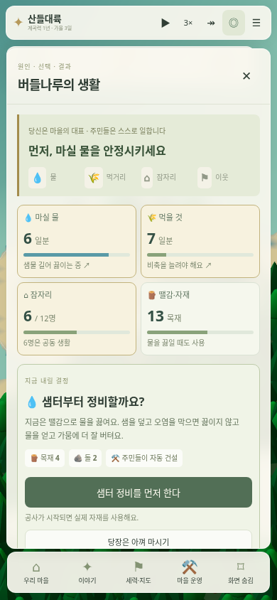
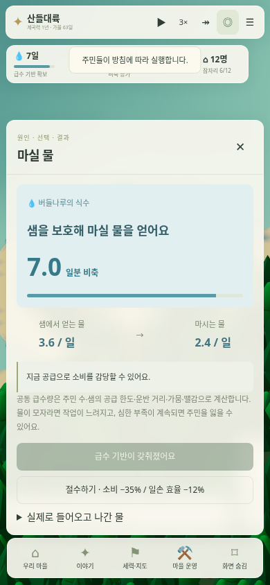
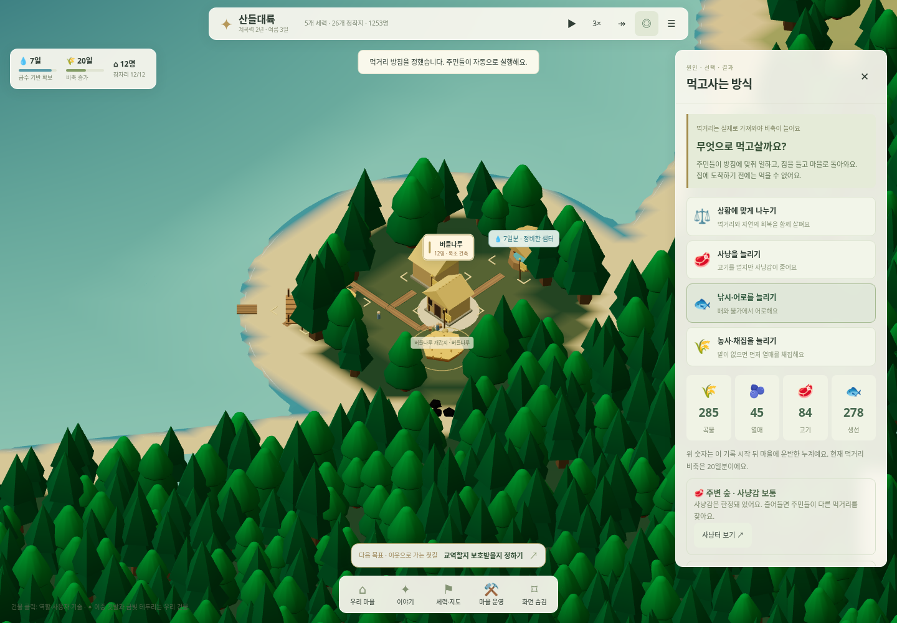
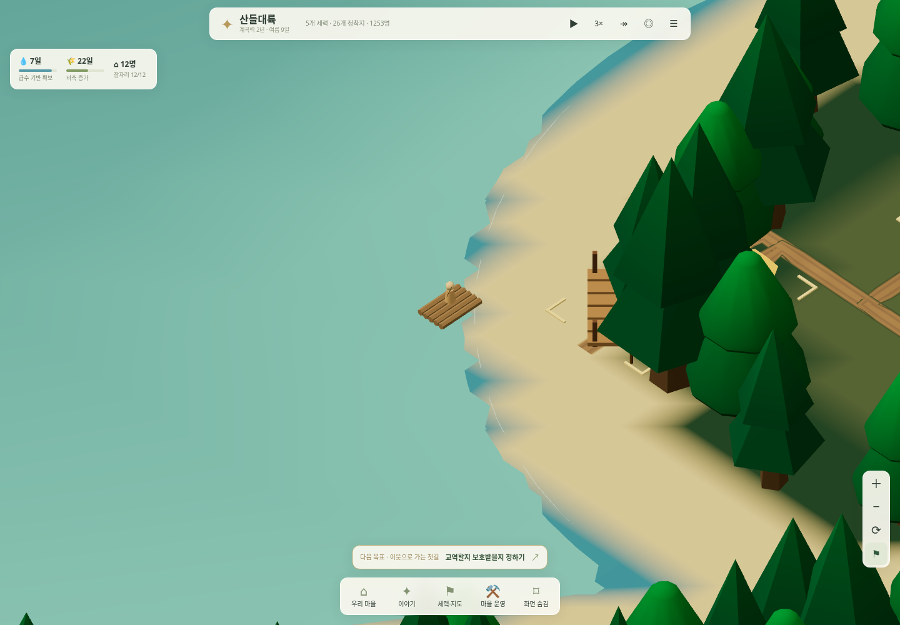

# 물을 확보하고, 먹고사는 방식을 정하는 마을

2026-11-01 · [실행](https://kkhkkh20-bit.github.io/everworld-game/frontier.html?v=11)

우리는 건물 위치나 주민 하나하나를 지시하지 않는다. **급수를 먼저 안정시킬지, 당장은 절수할지, 사냥·낚시·농사 중 어디에 일손을 쓸지** 결정한다. 주민은 실제 재료를 운반해 시설을 짓고 먹거리를 가져온다. 물·먹거리·잠자리·땔감을 네 카드로 보여주고, 당장 필요한 결정을 먼저 제시한다. 기존 교역·보호·외교는 접은 항목에서 이어서 선택할 수 있다.

## 처음 할 일

1. 하단 **내가 할 일** → **샘터 정비를 먼저 한다**. 목재 4·돌 2가 필요하다. 이미 자재를 쓴 공사는 보존하고 그 뒤에 진행한다. 당장 정비하기 어렵다면 절수한다.
2. 마을 창의 **먹을 것 카드** → **사냥·낚시·농사 방침**. 다른 선택으로 바꿔도 운반 중인 짐과 귀환 중인 배를 버리지 않는다.
3. **사냥터 보기 / 어장 보기**로 현장을 확인한다. 건물·계류장을 누르면 소속, 역할, 실제 사용하는 작업조를 볼 수 있다.
4. 기본 생활이 안정되면 잠자리와 이웃 관계를 정한다. 실제 변화는 기존 30일 비교와 기록에 남는다.

기본 게임 화면은 지도로 채우고, 상세 창은 눌렀을 때만 연다. 모바일에서도 첫 샘터 결정은 스크롤 전에 보인다.

## 마실 물

초기 조건에 **담수 샘과 6일분 식수**를 명시적으로 추가했다. 바닷물을 마시는 기능이 아니다. 하루 기본 소비는 남아 있는 주민 1명당 0.2다. 샘의 공급 한도, 거리, 공동 운반 노동, 시설 상태, 계절과 지역 가뭄이 공급을 제한한다. 비축 상한은 통상 8일분이다.

정비 전에는 새 식수 1당 목재 0.02를 써서 끓인다. 땔감이 없으면 새 식수가 들어오지 않는다. 기존 생활용 불과 함께 사용하는 것으로 계산해, 물에 실제 쓴 연료는 그날 생활용 목재 지출에서 중복 차감하지 않는다. 정비한 샘터는 이 처리 연료가 필요 없고 가뭄의 공급 감소도 작다. 샘터가 모든 가뭄이나 인구 증가를 무조건 해결하지는 않는다.

절수하면 소비가 35% 줄고 일손 효율 계수가 12% 낮아진다. 식수가 부족해도 효율이 떨어진다. 심각한 부족이 사흘 이상 이어지면 실제 사망과 인구 장부에 반영한다. 패널에서 **초기 식수 + 확보 − 소비 − 넘침 = 현재 비축**을 확인할 수 있다.

물 운반은 공동체 단위로 계산한다. 주민 모델이 물동이를 들고 매번 왕복하는 별도 직업 시뮬레이션은 아니다. 샘은 초기 설정이며 지하수·관개·홍수·질병 전체를 구현한 것은 아니다.

## 사냥·낚시·배

| 방침 | 주민의 실제 행동 | 대가와 한계 |
|---|---|---|
| 상황에 맞게 나누기 | 농장이 있으면 농사를 중심으로 사냥·가까운 낚시를 섞는다. 농업 전문 마을은 농사에 집중한다. | 먹거리 생산과 교역의 지역 차이를 유지한다. |
| 사냥 늘리기 | 숲으로 이동 → 사냥 → 고기를 짊어지고 창고로 귀환 | 한정된 사냥감이 줄고 숲·계절에 따라 천천히 회복한다. 부족하면 다른 먹거리를 찾는다. |
| 낚시·어로 늘리기 | 물가로 이동해 낚시. 배가 있으면 승선 → 어장 → 물가로 귀환 → 창고로 운반 | 물고기도 한정돼 있다. 고갈에 가까우면 다른 먹거리로 바꿔 회복을 기다린다. |
| 농사·채집 늘리기 | 밭에서 수확. 밭이 없으면 열매를 채집하며 농장을 준비 | 기존 토양·계절·기후·농장 효과를 사용한다. |

배는 **목재 8과 실제 공사**로 만든다. 한 척에 한 작업조만 타며, 배가 없으면 해안 낚시를 한다. 통나무배와 계류장을 지도에 표시하고 실제 탑승조의 위치로 움직인다. 발전한 마을에는 판자배 외형을 사용한다. 이번 배의 용도는 어로이며 해상 무역·여객·해전은 포함하지 않는다.

사냥감·물고기는 잡는 순간 서식지 수량에서 빠지고 주민의 짐이 된다. **창고 도착 전에는 마을 비축에 더하지 않는다.** 먹거리 창의 곡물·열매·고기·생선은 실제로 운반한 누계다. 현재 비축은 공통 먹거리 재고로 소비하므로 네 종류의 현재 수량이나 영양소를 따로 관리한다고 표시하지 않는다. 사슴 모델은 서식지의 대표 표시이며 개체별 번식·추적 모델은 아니다.

## 저장·구조·검증

식수·먹거리 로직은 `valley-water.js`, `valley-livelihood.js`, 결정 UI는 `valley-survival-ui.js`, 지도 표시는 별도 scene 모듈로 분리했다. 카메라·패널·지도 표시는 난수와 재고를 바꾸지 않는다. 기존 저장의 인구·자재·건물·시간·과거 기록은 보존하고, 새 식수 초기량과 먹거리 기록을 현재 시점부터 시작한다. 이미 정착한 공동체에는 기존 공동 급수 기반이 있다는 초기 가정을 쓰며, 없던 건설 기록을 만들어 넣지 않는다.

- `tests/survival.cjs`: 물·연료 장부, 절수·가뭄·실제 사망, 기존 저장 보존과 재적용, 실제 샘터·배 건설, 포획 후 운반, 한 배 한 작업조, 자원 한도, 배 이동 중 저장 재현, 30일 비교.
- `tests/survival-ui.cjs`: 1440px·390px 실제 조작, 첫 결정 가시성, 샘터·먹거리 창, 사냥·어로·실제 승선 화면, 읽기 전용 현장 이동, 저장과 화면 넘침·오류 검사. 위 이미지는 이 검사에서 직접 촬영했다.
- 기존 세계·세력·교역·건축·지형·이동·모바일·주민 활동 회귀 검사도 유지한다. 샘터와 생산 준비가 경제에 들어가면서 교역·보호의 도착 시점과 주택 수는 이전 버전과 달라진다. 특정 지원량이나 발전 순위를 강제하지 않는다.

이 기능으로 초반의 선택과 관찰 근거를 구체화했다. 재미와 장기 균형은 추가 플레이 피드백으로 평가해야 한다.

## 성능 확인

모바일 390×844, Chromium 154·SwiftShader 소프트웨어 GPU, 브라우저 CPU 4배 제한, 컨테이너 4코어 조건에서 다른 무거운 검사 없이 측정했다. 각 표본은 약 6초다. [원시 기록](survival-performance.json)에 실제 표본 길이·진행량·긴 작업·장면 통계를 함께 보관했다.

| 시나리오 | 새 원정 | 900일 진행 저장 |
|---|---:|---:|
| 일시정지한 전체 지도, 긴 작업 | 0회 | 0회 |
| 전체 지도 3배속, 실제 진행 | 6.16초 동안 6.7일 | 6.16초 동안 7.4일 |
| 마을 3배속, 실제 진행 | 6.75초 동안 7.2일 | 6.53초 동안 7.6일 |
| 마을 3배속 p95 rAF 간격 | 233ms | 150ms |

정지한 장면의 반복 그리기와 읽기 전용 화면 조작은 기존 캐시 검사로 확인했다. 전체 지도의 rAF 간격은 재사용하는 3D 배경의 FPS가 아니다. 소프트웨어 GPU의 확대 화면과 지도 이동에는 지연이 남으며, 이번 기능 추가로 모든 기기에서 렉이 해결됐다고 주장하지 않는다. 이전 성능 작업과 세계 경제·저장 내용이 달라 전후 향상률로 비교하지 않는다.
