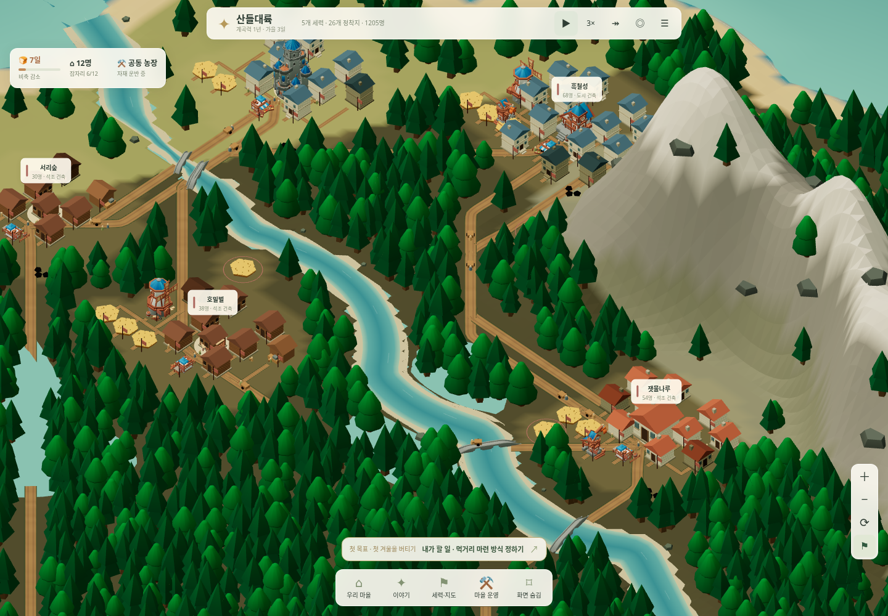

# 산과 강에 맞춘 흙길

[실행](https://kkhkkh20-bit.github.io/everworld-game/frontier.html?v=9) · [산자락의 길](../assets/screenshots/roads-mountain-1440.png) · [강과 산 사이](../assets/screenshots/roads-river-1440.png) · [대륙 전체](../assets/screenshots/roads-world-1440.png) · [휴대폰](../assets/screenshots/roads-mountain-390.png)

기존에는 마을 중심을 직선으로 연결하고 그 주변 산을 평평하게 깎았다. 길처럼 보이는 밝은 세력 경계선도 대륙을 대각선으로 가르고 있었다.

지금은 산의 높이·경사·강·해안을 함께 읽어서 길을 찾는다. 산자락과 낮은 고개를 이용하고, 바다를 건너지 않으며, 강을 건너는 비용을 높여 불필요한 횡단을 줄인다. 격자에서 찾은 경로는 경사를 다시 확인하면서 모서리를 다듬는다. 평탄한 곳에서는 곧은 구간이 남는다. 모든 길을 억지로 굽히는 방식은 아니다.

## 화면과 운송

- 흙길에 주변 땅과 섞이는 가장자리와 옅은 바퀴 자국을 표시한다. 마을 안쪽에는 건물 앞까지 작은 진입로를 그린다.
- 물에 잠기는 길 구간은 양쪽 강변을 잇는 다리로 대체한다. 다리 위치·방향·길이·높이는 같은 경로에서 구한다.
- 교역 수레와 이주민은 그 길의 좌표를 따라 이동한다. 교역 예상 시간도 직선 거리가 아닌 실제 길이로 계산한다. 경유 항구의 통행료는 기존처럼 실제 경유 때 처리한다.
- 정찰대와 원정대도 같은 지형 탐색을 사용한다. 정찰 뒤의 귀환과 원정 중단 뒤의 귀환은 현재 위치에서 시작한다. 원정대의 경작지 접근은 민간 교역망에만 제한하지 않는다.
- 세력 지도에도 실제 굽은 길을 그린다. 정치 경계는 흐리고 간격이 넓은 점선으로 표시해 길과 구분한다.

새 강의 위치는 고정된 도시·밭 구역을 피하도록 계산한다. 건물이 자라거나 교역로가 추가되어도 강·산·해안이 움직이지 않는다. 지도와 시뮬레이션이 같은 지형 함수를 사용하며, 길을 보거나 예상 시간을 조회하는 동작은 자원·인구·난수·역사를 바꾸지 않는다.

## 저장과 실제 결과

기존 저장의 길에는 경로를 추가한다. 운송 중인 물자와 현재 좌표는 유지하고 그 자리에서 남은 길을 이어간다. 옛 도로를 평평하게 만들던 산등성이에 남아 있는 수레는 출발 주변에서만 경사 제한을 완화한 합류 경로를 저장한다. 새로 건설하는 길에는 이 예외를 쓰지 않는다. 이미 새 경로를 사용하는 수레와 길은 재접속해도 유지한다. 이전 마을과 새 대륙의 저장 슬롯 구분도 그대로다.

우회와 귀환에 시간이 실제로 들기 때문에 거래 도착, 공급 부족, 외교와 전쟁 발생 시점은 이전 직선 이동과 달라질 수 있다. 상대가 길 개척 뒤에도 곡물을 내보낼 수 있는지는 그때의 재고에 달렸다. 겨울 비교 검증은 가까운 곡창 마을과의 실제 거래·원조를 사용하고, 자율 전쟁은 여러 시드에서 확인한다. 모든 세계에 전쟁이 반드시 발생하도록 강제하지 않는다.

## 확인한 항목

- `node tests/terrain-roads.cjs`: 기존 33개 길, 산등성이를 피하는 4개 우회, 정렬된 19개 다리, 급경사·바다 회피, 지형 고정, 관찰 순서와 무관한 재현, 실제 수레 이동·물자 보존, 운송 중 저장 이행.
- `node tests/landscape.mjs`, `node tests/continent.mjs`: 강·숲·마을 침수 방지와 대륙 형태, 오래 진행한 저장, 관찰 불변.
- `node tests/terrain-roads-ui.cjs`: 1440px PC·390px 휴대폰의 산길·강변·전체 지도·세력 지도, 저장된 길 재접속, 일시정지 관찰 불변, 브라우저·에셋 오류 검사. 기본 스크린샷은 임시 폴더에 저장하며 `EVERWORLD_ROAD_ARTIFACTS`로 지정할 수 있다.
- `node tests/road-save-ui.cjs`: 휴대폰 브라우저에서 옛 산등성이 교역 수레의 합류·도착·위치 연속성과 물자 보존.
- 기존 첫겨울·세력·건축·물자/인구 회계·이전 모드와 주민 움직임·정지 화면 갱신 검사도 함께 실행한다.

지형 탐색은 유한한 격자와 비용을 쓰는 시제품이다. 실제 토목 공사, 절토·성토량, 다리 하중, 선박 운송을 계산하는 시스템을 추가한 것은 아니다.
