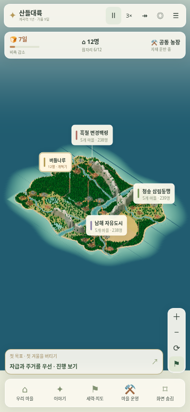
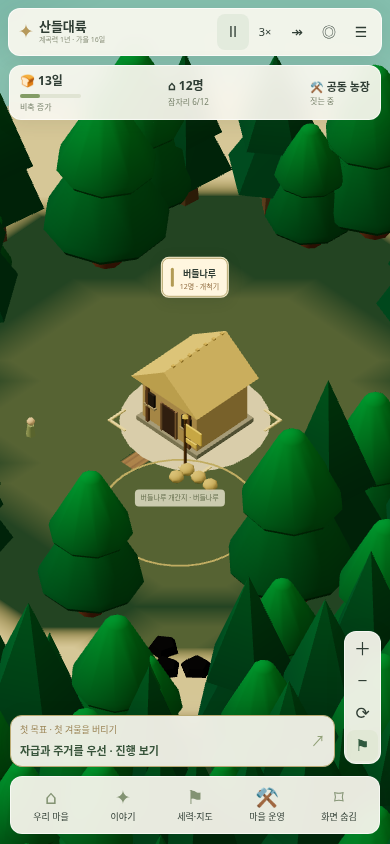

# 현재 3D 마을의 성능 점검과 모듈 분리

[실행](https://kkhkkh20-bit.github.io/everworld-game/frontier.html?v=10) · [원시 측정](valley-performance.json)

기준은 `c475313`의 `frontier.html`이다. 예전 2D 관찰 모드의 성능과 현재 3D 게임의 성능을 구분했다. 같은 시드 7341의 초기 저장과 정착 후 900일 지난 저장을 사용했다. 초기에는 26개 마을·355개 건물, 오래된 저장에는 410개 건물이 있다.

## 원인

측정에서 큰 프레임 정지는 전체 3D 장면을 제출하는 동안 발생했다. 전체 지도의 주민 모델은 이미 숨겨져 있었지만, 수레 점을 이동시킬 때마다 숲·건물·지형까지 다시 그렸다. 그림자도 고정된 물체에 대해 반복 계산했다. 소프트웨어 GPU를 쓰는 테스트 환경에서 전체 지도 이동·진행 중 긴 멈춤이 확인됐다.

코드와 추가 검사에서는 다음 낭비도 확인했다.

- 건물 하나의 재료·소속이 바뀌면 전체 마을의 건물, 모든 도로와 다리를 다시 만들었다.
- 큰 지형·도로 묶음 때문에 가까이 확대해도 화면 밖의 많은 삼각형을 GPU에 보냈다.
- 길 위의 위치를 계산할 때 같은 선분의 거리를 계속 구했다. BFS가 같은 경로를 새 배열로 반환하면 배열 기반 캐시도 재사용되지 않았다.
- 수레와 주민마다 같은 짐·바퀴 도형을 새로 만들었다.
- 첫 분리 이후에도 새 건물의 진입로 하나를 추가할 때 도로를 전부 구역별로 다시 묶는 작업이 약 0.4초 걸렸다. 최종 구현에서는 해당 도로 구역만 다시 합친다.

## 분리한 책임

| 모듈 | 역할 |
|---|---|
| [valley-runtime.js](../js/valley-runtime.js) | 시간·배속·일시정지·화면·저장 주기와 진단 시간 |
| [valley-polyline.js](../js/valley-polyline.js) | 순수한 선분 길이·경로 표본·위치 계산 |
| [valley-travel.js](../js/valley-travel.js) | 저장 바깥의 이동 경로 캐시, 세계·도로 변경 시 무효화 |
| [valley-scene-geometry.js](../js/valley-scene-geometry.js) | 해상도를 유지한 지형 분할과 도로 구역 생성 |
| [valley-scene-roads.js](../js/valley-scene-roads.js) | 도로 표면·진입로·다리 유지와 바뀐 구역 갱신 |
| [valley-scene-buildings.js](../js/valley-scene-buildings.js) | 바뀐 마을의 건물만 갱신, 클릭 대상 보존 |
| [valley-scene-forest.js](../js/valley-scene-forest.js) | 숲의 공간 분할, 가까운 원본 모델과 먼 지도용 모델 |
| [valley-scene-actors.js](../js/valley-scene-actors.js) | 주민·수레·군대의 공용 도형과 모델 생성 |
| [valley-scene-markers.js](../js/valley-scene-markers.js) | 전체 지도에서 이동하는 수레·군대의 가벼운 표시 |

`valley-view.js`는 장면 구성·카메라·선택·갱신 연결을 맡고, `valley-ui.js`는 정보와 입력을 연결한다. 지형 탐색은 기존 `valley-paths.js`, 지형 정의는 `valley-world-geometry.js`가 맡는다. UI의 모든 설명문이나 게임 규칙을 한꺼번에 다시 작성하지 않았다.

## 화면 갱신

전체 지도에서는 배경을 유지하고 이동 표지만 별도로 갱신한다. 실제 건물·길·소속이 달라지거나 카메라가 움직이면 3D 배경을 갱신한다. 가까이 확대하면 기존 모델과 그림자를 복원한다. 먼 지도에서는 작은 자루·공사 진행·투영 그림자를 생략하고 나무를 같은 위치·색·크기의 간단한 수관으로 표시한다. 숲의 수나 게임 자원을 줄이지 않는다.

지형은 기존 격자와 색을 유지한 채 나눠 화면 밖 구역을 제외한다. 도로는 표면을 재사용하고, 새 진입로는 해당 구역에만 합친다. 건물의 재료나 소유자 변화는 도로를 재생성하지 않는다. 고정 그림자는 건물·숲 등 실제 투영 대상이 바뀔 때 갱신한다. 일시정지한 화면은 반복 그리지 않는다.

## 전후 측정

| 항목 | 수정 전 | 수정 후 |
|---|---:|---:|
| 초기 저장 로딩 | 21.47초 | 12.85초 |
| 오래된 저장 로딩 | 28.74초 | 13.09초 |
| Node에서 900일 연산 | 1.69초 | 1.02초 |
| 초기 마을 3배속 p95 rAF 간격 | 450ms | 217ms |
| 오래된 마을 3배속 p95 rAF 간격 | 483ms | 217ms |
| 초기 전체 지도 진행 중 가장 긴 작업 | 1699ms | 885ms |
| 오래된 전체 지도 진행 중 가장 긴 작업 | 1703ms | 81ms |
| 초기 지도 이동 중 가장 긴 작업 | 1669ms | 823ms |
| 오래된 지도 이동 중 가장 긴 작업 | 1905ms | 870ms |

초기 전체 지도 3배속의 실제 진행은 8.19초 동안 0.9일에서 6.15초 동안 6.5일로 바뀌었다. 계산을 생략해 프레임 수만 높인 결과로 설명하지 않는다. 원시 기록에 실제 진행량과 표본 길이가 함께 있다.

집 한 채가 추가되는 표본에서 도로 구역은 전체 62개 대신 주변 2개만 다시 만들었다. 해당 마을 갱신 최대 시간은 중간 구현의 389ms에서 최종 구현의 22ms로 줄었다. 중간 구현은 최종 비교표의 기준 버전과 구분한다.

 

## 보존과 검증

생산·교역·전쟁·건축 기술의 규칙과 저장 슬롯은 유지했다. 같은 초기 상태와 900일 후의 **전체 저장 JSON이 기준 버전과 정확히 일치**하는 것을 확인했다. 이동 계산은 선분 길이를 미리 구하면서 기존 부동소수점 뺄셈 순서를 유지한다. 캐시는 저장 파일이나 경제·난수·역사에 기록하지 않는다.

- `tests/valley-runtime.mjs`: 배속·고정 간격·일시정지·숨긴 탭·저장/정보 갱신 주기.
- `tests/valley-travel.cjs`: 같은 경로의 재사용, 다른 세계·교체/삭제된 도로의 무효화, 계산 정확도, 관찰 불변.
- `tests/valley-render-cache.cjs`: 한 마을만 갱신, 개축 시 도로/다리 재생성 없음, 새 집의 진입로와 인접 구역만 갱신, 수레 100개의 공용 도형, 정지 화면, 크기 변경과 상세도 전환.
- 기존 경제·인구 회계, 첫겨울, 건축·건물 선택, 도로/다리, 이전 저장, PC·휴대폰·가로 화면 검사를 실행했다.
- 필수 `tests/render-budget.cjs`, `tests/resident-activity.cjs`, `tests/simulate.mjs`, `tests/performance-review.cjs`도 확인했다. 마지막 항목은 원래 의도한 이전 모드를 검사하도록 새 게임으로 보내는 진입 스크립트만 테스트 HTML에서 제외했다.

## 측정 조건과 한계

Chromium, 390×844 CSS 픽셀, CPU 4배 제한, 클라우드의 소프트웨어 GPU 조건이다. 컨테이너 CPU 한도는 `400000 / 100000`으로 4코어 상당이다. 초기와 오래된 저장을 각각 정지·지도 이동·전체 지도 3배속·마을 3배속으로 측정했다. 각 표본은 6초 대기이며 실제 경과 시간·실제 진행 일수·프레임 수·긴 작업 시간을 함께 기록했다. 다른 CPU 집약 검사와 동시에 측정하지 않았다.

rAF 간격은 3D 렌더 FPS가 아니다. 전체 지도에서는 배경을 재사용하므로 이 값을 전체 3D 장면의 60FPS로 설명하면 안 된다. 소프트웨어 GPU와 CPU 제한 조건의 확대 화면은 목표 50ms에 못 미치는 지연이 남는다. 실제 휴대폰의 하드웨어 GPU에서 같은 수치를 보장하지 않으며, 한 차례의 전후 측정을 일반적인 향상률로 주장하지 않는다.

재현할 때 성능 검사를 다른 무거운 검사와 병렬 실행하지 않는다.

```sh
node tests/valley-runtime.mjs
node tests/valley-travel.cjs
node tests/valley-render-cache.cjs
VALLEY_ENGINE_PERF_OUT=/tmp/valley-engine-perf node tests/valley-engine-performance.cjs
VALLEY_PERF_OUT=/tmp/valley-perf node tests/valley-performance.cjs
```

`VALLEY_PERF_FIXTURES`에 `fresh.json`과 `aged.json`을 둔 폴더를 지정하면 저장을 고정한다. `VALLEY_PERF_SOURCE`에는 이전 파일을 읽기 전용으로 추출한 폴더를 지정할 수 있다. 앱의 파일을 교체하거나 별도 체크아웃을 만들지 않고, 테스트 HTTP 응답에서만 해당 소스를 사용한다.
