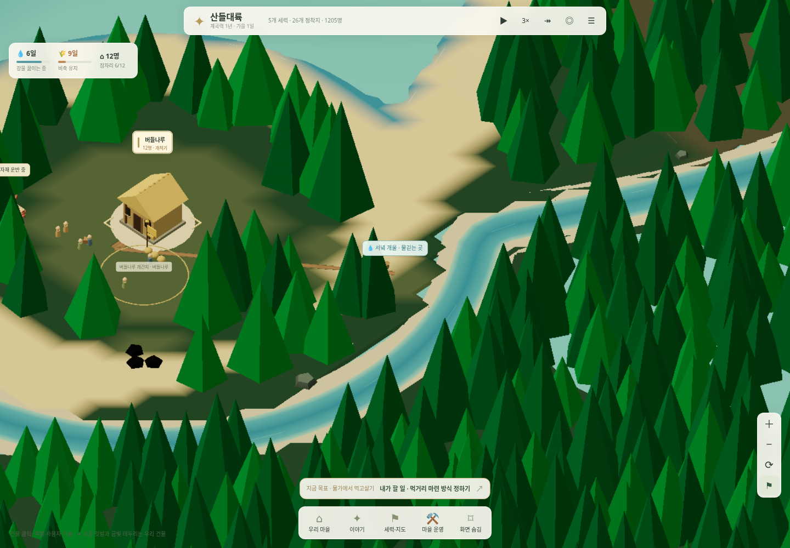
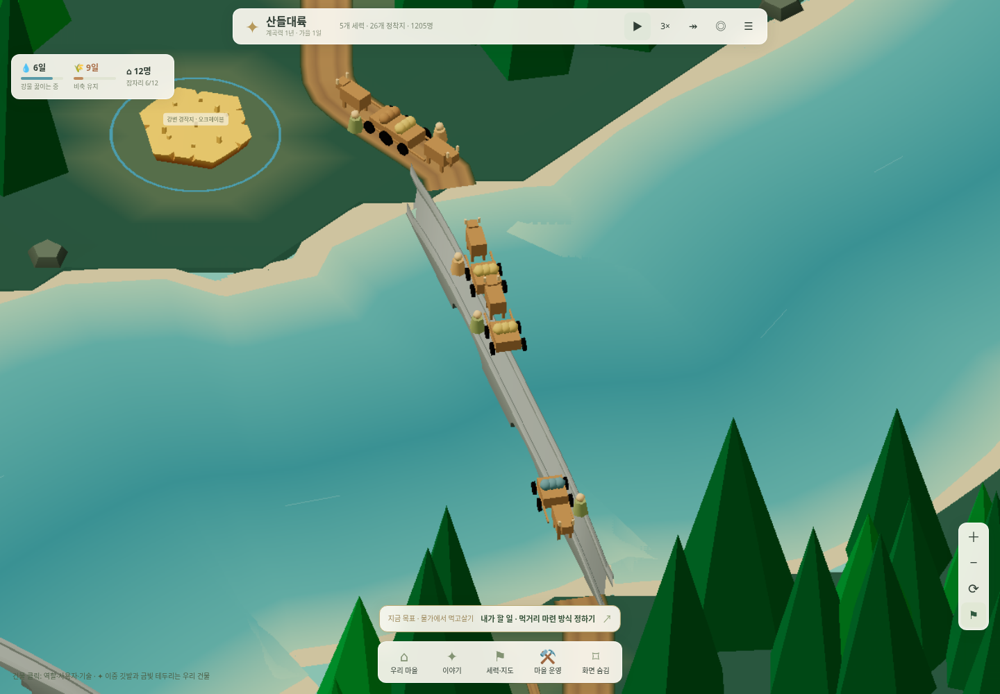
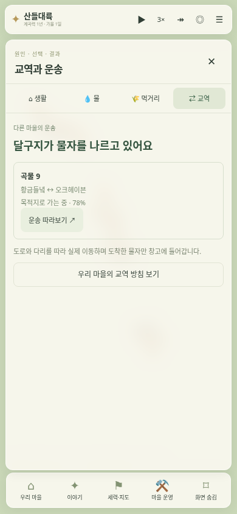
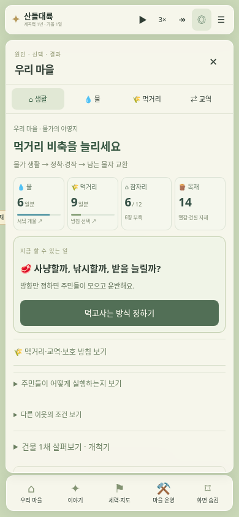

# 물가에 정착하고 남는 물자를 교환하는 마을

v12 구현 당시의 기록입니다. 현재 길·운송 규칙은 [v13 생존·길 투자](frontier-survival.md)를 따릅니다. 통행만으로 길이 넓어지는 규칙은 제거했습니다.

2026-11-01 · [게임 실행](https://kkhkkh20-bit.github.io/everworld-game/frontier.html?campaign=watershed&v=12)

우리 마을의 출발을 **물가 생활 → 정착·경작 → 남는 물자의 교환**으로 정리했다. 생활과 생산은 주민이 자동으로 실행하고, 플레이어는 먹거리·자재·교역의 우선순위를 정한다. 수렵·채집과 초기 농경 정착의 관계를 참고한 게임 단계이며 신석기부터 모든 시대의 역사를 재현한 모델은 아니다. 주변의 기존 도시들은 발전한 상태를 유지한다.

## 주변 물을 이용하는 정착

새 원정에는 서쪽 해안으로 흐르는 작은 개울이 있다. 마을 옆에 보이는 그 하천에서 물을 확보한다. 모든 마을의 취수 지점은 실제 하천에서 찾고, 바다와 하구에 너무 가까운 지점은 제외한다. 같은 쪽 물가까지 걸어서 접근할 수 있는 경로와 거리를 계산한다. 물이 있는 곳과 생활 기반의 관계를 지도에서 확인할 수 있다.

취수·저장 시설은 그릇을 모으고 운반과 보관을 돕는 자리다. **시설이 있어도 강물은 끓여야 한다.** 초기에는 주변 강물을 이용하며 먹거리를 마련하는 선택부터 시작할 수 있다. 시설 건설을 필수 첫 버튼으로 강요하지 않는다. 실제 공급 여력이 부족하거나 직접 우선 지시했을 때 취수·저장을 정비한다.

- 공급 여력은 하천의 크기·가뭄·계절·시설 상태·실제 취수 길·공동 운반 노동으로 제한한다.
- 기본 식수 소비는 주민당 하루 0.2다. 새 원정의 초기 식수 6일분은 시작 자원이다.
- 강물을 끓이는 목재는 물 1당 0.02, 운반·저장을 정비하면 0.015다. 기존 생활용 불과 연료를 공유하므로 중복 차감하지 않는다.
- 취수 시설 전에는 통상 8일분, 정비 뒤에는 12일분까지 비축한다. 절수는 소비를 35% 줄이고 일손 효율 계수를 12% 낮춘다. 심각한 부족은 실제 사망 장부로 이어진다.
- 물 운반은 공동체 단위 계산이다. 물동이를 든 주민 개체별 왕복이나 관개·범람·질병 전체를 추가한 것은 아니다.

## 잉여와 교역로

이웃과 연결되지 않은 우리 마을은 정찰과 자재를 마련해야 한다. 경로는 기존 산자락·고개를 따르는 지형 탐색을 사용한다. **강을 건너는 구간의 다리 길이로 추가 자재와 공사 기간을 계산**한다. 교역 창에서 상대와 물물교환 조건, 길·다리의 실제 비용을 함께 본다.

기본 흙길은 목재 12·돌 3, 각 다리는 길이에 따라 목재 `ceil(길이 × 0.18)`, 돌 `ceil(길이 × 0.035)`, 추가 공사일 `ceil(길이 / 12)`을 요구한다. 기본 공사 9일과 실제 이동 시간도 적용한다. 기본 씨앗에서 호밀벌로 가는 첫 길은 다리 1개를 포함해 목재 14·돌 4다. 자재를 실제로 지불하고 공사가 끝나야 연결되고, 이후 수레가 건널 수 있다.

길은 교역을 위해 연결한다. 군대도 기존 길과 지형을 이용하며, 전쟁과 통행 위험은 교역을 중단시킬 수 있다. 군사 이동으로 교역량을 늘리지 않는다. 실제 물자 운송이 구간을 지나면 그 양과 횟수를 기록한다. 새로 연 길은 통행이 쌓이면서 좁은 길에서 더 넓은 흙길로 바뀐다. 기존 저장에 없던 과거 통행량은 만들어 넣지 않는다.

## 짐을 나르는 사람과 수레

발송 공동체의 건축 단계에 따라 짐썰매·손수레·달구지를 표시한다. 새 운송은 발송 시 이동 수단을 저장하고 이동 방향과 회전하는 바퀴, 싣고 있는 짐을 보여준다. 기본 세계에서 실제 운송 중인 수레를 촬영했다.

수레를 누르면 그 운송의 소속·출발지·목적지·물자·운송/귀환 상태를 확인할 수 있다. 목적지나 돌아올 창고에 실제 도착해야 재고를 지급한다. 기존 교환 물자의 예약·왕복 수송·통행료·조공 회계를 유지한다. 어로용 배와 해상 무역은 구분하며 이번에 해상 무역 체계를 추가하지 않았다.

취수 시설이나 배를 우선 지시했을 때 자재가 부족하면 건설조도 숲·채석장에서 필요한 자재를 구해 창고로 가져온다. 생산량만 갑자기 올리는 대신 기존 자원 채집·운반·저장 규칙을 함께 쓴다. 이 작업 중의 저장도 재현한다.

## 관리 화면

창 위의 **생활 / 물 / 먹거리 / 교역**으로 바로 이동한다. 첫 화면에는 물·먹거리·잠자리·목재와 지금 가능한 행동을 보여준다. 먹거리 창은 네 방침부터 보여주고, 교역 창은 준비 비용과 실제 도착 상태를 보여준다. 펼친 설명과 키보드로 선택한 버튼은 실시간 수치 갱신 때 유지한다. 모바일에서 창을 열면 뒤쪽의 중복 상태 표시를 숨긴다.

설정의 화면 품질은 **자동 / 부드럽게 / 자세히**다. 자동은 모바일과 소프트웨어 GPU에서 낮은 해상도와 간소한 먼 나무·그림자 설정을 사용한다. 마을 인구·생산·시간 진행은 품질 설정으로 바꾸지 않는다.

## 저장과 검증

기존 저장의 마을·건물 위치, 지형과 교역로, 물·자재 비축, 인구, 시간, 난수와 과거 기록을 보존한다. 이전의 자동 샘 지점은 해당 저장의 실제 하천 취수 지점으로 전환하고 기존 물 장부를 유지한다. 이미 지은 시설은 옮기지 않고 급수·저장 시설로 계속 쓴다. 서녘 개울을 포함하는 새 지형은 새 원정에 적용한다. 실행 링크의 물가 원정은 `everworld_watershed_v1`에 별도로 저장해 기존 대륙 저장을 덮어쓰지 않는다. 설정에서 두 원정을 오갈 수 있다. 기존 마을에서 물가가 멀면 그 운반 거리도 실제로 적용된다.

- `tests/watershed-trade.cjs`: 실제 담수와 같은 쪽 접근 경로, 가까운 초기 정착, 과거 저장·지형·재고 보존, 다리 추가 비용과 실제 지급, 완공 전 통행 금지, 실물 운송량과 자원 보존.
- `tests/survival.cjs`: 식수·연료·인구 회계, 가뭄·절수, 실제 채집·어로·배, 자재를 직접 모으는 건설조, 저장 재현.
- `tests/watershed-ui.cjs`, `tests/commerce-ui.cjs`: PC·모바일의 실제 취수·선택·교역 비용·수레 클릭·순수한 관찰·저장·화면 넘침 및 오류 검사. 위 화면은 이 검사에서 직접 촬영한다.
- `tests/scene-depth-cache.cjs`: 배경 색과 깊이 보존, 나무 뒤·앞을 지나는 이동 물체, 배경 재사용과 갱신, GPU 복사와 셰이더 경로.
- `tests/scene-motion.mjs`: 화면 좌표만 보간하고 실제 주민·수레 상태와 난수를 건드리지 않으며, 일시정지하면 화면도 멈춘다.
- 기존 세력·분쟁·건축·산길·주민·지도 갱신·이전 게임·10개 세계 검사를 유지한다.

성능 원인과 같은 시야의 전후 측정은 [확대 화면 갱신과 성능](watershed-performance.md)에 기록한다.
